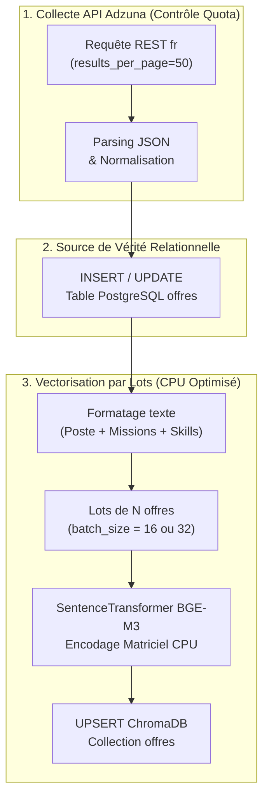

# Guide d'Implémentation du Connecteur API Adzuna & Ingestion par Lots
> Projet Master 2 IA — Recommandation d'offres d'emploi par analyse de CV  
> Composant : Ingestion d'offres d'emploi (`src/scrapers/adzuna_scraper.py`) & Indexation (`src/pipeline/`)  
> Basé sur la spécification officielle OpenAPI : [`docs/Adzuna.json`](file:///C:/MASTER2_IA/Projet_CV/docs/Adzuna.json)

Ce document fournit l'analyse technique complète de l'API Adzuna pour le marché français, le code source robuste du scraper, ainsi que la stratégie d'**ingestion par lots (batching)** et de **contrôle strict des quotas d'API**.

---

## 1. Analyse Technique & Gestion des Quotas

### 1.1 Endpoint & Spécification REST
* **URL de base** : `https://api.adzuna.com/v1/api`
* **Route de recherche** :
  ```http
  GET /jobs/{country}/search/{page}
  ```
* **Paramètres obligatoires** :
  * `country` : Code ISO **`fr`** pour la France.
  * `page` : Entier débutant à `1`.
  * `app_id` : Identifiant client issu de `developer.adzuna.com`.
  * `app_key` : Clé secrète d'API.

### 1.2 Gestion Intelligente du Quota Journalier (250 requêtes / jour)
Le plan gratuit développeur Adzuna autorise **250 requêtes HTTP par jour**.  
Pour maximiser l'efficacité de chaque appel sans jamais gaspiller de quota :

* **Maximiser les résultats par appel** : Utiliser `results_per_page=50` (le maximum optimal).
  $$\text{1 requête API} = 50 \text{ offres réelles récupérées}$$
  $$\text{10 requêtes API} = 500 \text{ offres réelles récupérées}$$
* **Consommation réelle** : Remplir une base de démonstration solide (500 offres denses) ne consomme que **4 % du quota journalier** (10 requêtes sur 250) !
* **Sécurité Anti-Dépassement** : Le scraper intègre un compteur de requêtes pour s'arrêter avant d'atteindre la limite.

---

## 2. Stratégie d'Ingestion : "Start Small" & Batch Embedding



### Pourquoi le traitement par lots (Batching) est crucial sur CPU :
Sur une machine sans GPU dédié (processeur Intel standard) :
* ❌ **Encodage unitaire (boucle `for`)** : Lance une passe avant PyTorch pour chaque texte individuel $\rightarrow$ temps d'overhead énorme.
* ✅ **Encodage par lots (`batch_size=16` ou `32`)** : PyTorch regroupe les calculs d'algèbre linéaire en opérations matricielles vectorisées $\rightarrow$ **3 à 5 fois plus rapide**, charge CPU constante et pas de surchauffe.

---

## 3. Table de Mapping : Adzuna ➔ Schéma PostgreSQL `offres`

| Champ JSON Adzuna (`Job`) | Type Adzuna | Champ PostgreSQL (`offres`) | Règle de transformation & Robustesse |
| :--- | :--- | :--- | :--- |
| `id` | `string` | `id` | Préfixé de manière unique : `f"adzuna_{job['id']}"` |
| `title` | `string` | `poste` | Titre épuré (`strip()`) |
| `company.display_name` | `string` | `company` | Nom de l'employeur (ou `"Entreprise non spécifiée"`) |
| `location.display_name` | `string` | `location` | Ex: `"Paris, Île-de-France"` |
| `contract_type` / `contract_time` | `string` | `type_de_contrat` | `permanent` ➔ `CDI`<br>`contract` ➔ `CDD / Mission`<br>`part_time` ➔ `Temps partiel` |
| `description` | `string` | `description` & `mission` | Corps de l'annonce préservé |
| `redirect_url` | `string` | `source_url` | Lien web officiel vers l'offre d'origine |
| `salary_min` / `salary_max` | `number` | Métadonnées | Rémunération indicative si fournie |
| `created` | `string (ISO 8601)`| `created_at` | Horodatage de publication |

---

## 4. Code Source de Production

### 4.1 Interface Abstraite : `src/scrapers/base_scraper.py`
Garantit l'uniformité entre Adzuna, JobSpy et les futurs scrapers :

```python
"""
src/scrapers/base_scraper.py
Classe de base abstraite unifiant tous les scrapers du projet.
"""

from abc import ABC, abstractmethod
from typing import List, Dict, Any


class BaseJobScraper(ABC):
    def __init__(self, name: str):
        self.name = name

    @abstractmethod
    def search_jobs(
        self,
        query: str,
        location: str = "France",
        limit: int = 20,
        **kwargs: Any
    ) -> List[Dict[str, Any]]:
        """Retourne une liste de dictionnaires normalisés représentant des offres d'emploi."""
        pass
```

---

### 4.2 Connecteur Adzuna : `src/scrapers/adzuna_scraper.py`
Intègre la gestion d'erreurs (410, 400, timeouts), le suivi du quota et la pagination :

```python
"""
src/scrapers/adzuna_scraper.py
Connecteur officiel pour l'API REST Adzuna France avec suivi de quota.
Spécification OpenAPI : docs/Adzuna.json
"""

import logging
from typing import List, Dict, Any, Optional
import requests

from src.config import settings
from src.scrapers.base_scraper import BaseJobScraper

logger = logging.getLogger(__name__)


class AdzunaScraper(BaseJobScraper):
    """
    Connecteur API REST pour Adzuna France.
    Prend en charge la pagination, le filtrage sectoriel et le suivi du quota journalier.
    """

    BASE_URL = "https://api.adzuna.com/v1/api/jobs"

    def __init__(
        self,
        app_id: Optional[str] = None,
        app_key: Optional[str] = None,
        country: str = "fr"
    ):
        super().__init__(name="Adzuna")
        self.app_id = app_id or settings.ADZUNA_APP_ID
        self.app_key = app_key or settings.ADZUNA_APP_KEY
        self.country = country.lower()
        self.requests_count = 0  # Compteur local de requêtes effectuées

    def _normalize_contract(self, contract_type: Optional[str], contract_time: Optional[str]) -> str:
        """Normalise les types contractuels Adzuna vers les conventions françaises."""
        if contract_type == "permanent":
            return "CDI"
        if contract_type == "contract":
            return "CDD / Mission"
        if contract_time == "part_time":
            return "Temps partiel"
        return "Non spécifié"

    def search_jobs(
        self,
        query: str = "",
        location: str = "Paris",
        limit: int = 20,
        page: int = 1,
        distance_km: int = 25,
        max_days_old: Optional[int] = 30,
        category: Optional[str] = "it-jobs",
        **kwargs: Any
    ) -> List[Dict[str, Any]]:
        """
        Recherche des offres d'emploi en France via l'API Adzuna.

        Args:
            query (str): Mots-clés recherchés (ex: "Data Scientist", "Python"). Vide = tout métier.
            location (str): Ville ou région de recherche.
            limit (int): Nombre d'offres souhaité par page (maximum recommandé : 50).
            page (int): Numéro de la page (commence à 1).
            distance_km (int): Rayon kilométrique de recherche.
            max_days_old (int, optionnel): Fraîcheur des annonces en jours.
            category (str, optionnel): Filtre secteur ("it-jobs" pour la tech).

        Returns:
            List[Dict[str, Any]]: Liste d'offres standardisées.
        """
        if not self.app_id or not self.app_key:
            logger.error(
                "❌ Clés Adzuna manquantes ! Renseignez ADZUNA_APP_ID et ADZUNA_APP_KEY dans votre fichier .env"
            )
            return []

        endpoint = f"{self.BASE_URL}/{self.country}/search/{page}"
        params: Dict[str, Any] = {
            "app_id": self.app_id,
            "app_key": self.app_key,
            "results_per_page": min(max(limit, 1), 50),
            "where": location,
            "distance": distance_km,
            "sort_by": "relevance",
        }

        # N'ajoute le paramètre 'what' que si une requête est spécifiée
        if query and query.strip():
            params["what"] = query.strip()

        if max_days_old:
            params["max_days_old"] = max_days_old
        if category:
            params["category"] = category

        logger.info(
            f"🔍 Requête Adzuna [Appel #{self.requests_count + 1}] | Query='{query}' | Where='{location}' | Page={page}"
        )

        try:
            response = requests.get(endpoint, params=params, timeout=12)
            self.requests_count += 1

            if response.status_code == 410:
                logger.error("❌ Erreur 410 Adzuna : ADZUNA_APP_ID ou ADZUNA_APP_KEY invalide.")
                return []

            if response.status_code != 200:
                logger.error(f"❌ Erreur HTTP {response.status_code} Adzuna : {response.text}")
                return []

            data = response.json()
            raw_jobs = data.get("results", [])
            total_available = data.get("count", 0)
            logger.info(f"📊 Adzuna : {total_available} offres disponibles au total sur ces critères.")

        except requests.exceptions.RequestException as e:
            logger.error(f"❌ Erreur réseau lors de l'appel Adzuna : {e}")
            return []
        except ValueError as e:
            logger.error(f"❌ Réponse JSON Adzuna invalide : {e}")
            return []

        results: List[Dict[str, Any]] = []

        for item in raw_jobs:
            title = str(item.get("title", "")).strip()
            description = str(item.get("description", "")).strip()

            if not title or len(description) < 20:
                continue

            company_info = item.get("company", {})
            company_name = company_info.get("display_name", "Entreprise non spécifiée") if isinstance(company_info, dict) else "Entreprise non spécifiée"

            location_info = item.get("location", {})
            location_name = location_info.get("display_name", location) if isinstance(location_info, dict) else location

            contract = self._normalize_contract(
                contract_type=item.get("contract_type"),
                contract_time=item.get("contract_time")
            )

            results.append({
                "source": "adzuna",
                "external_id": f"adzuna_{item.get('id')}",
                "poste": title,
                "company": company_name,
                "location": location_name,
                "type_de_contrat": contract,
                "remote_policy": "Non spécifié",
                "description": description,
                "mission": description,
                "source_url": item.get("redirect_url", ""),
                "salary_min": item.get("salary_min"),
                "salary_max": item.get("salary_max"),
                "created_at": item.get("created"),
            })

        logger.info(f"✅ Adzuna : {len(results)} offres exploitables retenues (Total requêtes session: {self.requests_count}).")
        return results
```

---

### 4.3 Script de Test Léger ("Start Small") : `tests/test_adzuna.py`

Ce script teste la récupération de **3 offres réelles** pour valider la chaîne sans consommer de quota inutilement :

```python
"""
tests/test_adzuna.py
Validation unitaire légère du connecteur Adzuna France.
"""

import sys
from pathlib import Path

# Résolution des imports
sys.path.insert(0, str(Path(__file__).resolve().parent.parent))

# Résolution d'encodage pour le terminal Windows
if hasattr(sys.stdout, "reconfigure"):
    sys.stdout.reconfigure(encoding="utf-8")

from src.scrapers.adzuna_scraper import AdzunaScraper
from src.config import settings


def main():
    print("=" * 65)
    print("🚀 TEST UNITAIRE DU CONNECTEUR ADZUNA (FRANCE)")
    print("=" * 65)

    if not settings.ADZUNA_APP_ID or not settings.ADZUNA_APP_KEY:
        print("\n⚠️ Clés Adzuna non configurées dans le fichier .env !")
        print("1. Rendez-vous sur https://developer.adzuna.com")
        print("2. Renseignez ADZUNA_APP_ID et ADZUNA_APP_KEY dans .env")
        return

    print(f"\n[1/3] Identifiant détecté : APP_ID={settings.ADZUNA_APP_ID[:4]}****")

    # Recherche légère : 3 offres à Paris
    scraper = AdzunaScraper(country="fr")
    query = "Data Scientist"
    location = "Paris"
    limit = 3

    print(f"\n[2/3] Exécution de la requête test...")
    print(f"      Poste : '{query}'")
    print(f"      Lieu  : '{location}'")
    print(f"      Limite: {limit} offres")

    jobs = scraper.search_jobs(query=query, location=location, limit=limit)

    print(f"\n[3/3] Analyse des données reçues : {len(jobs)} offre(s)")

    if not jobs:
        print("❌ Aucune offre reçue. Vérifiez la connexion ou vos clés.")
        return

    for i, job in enumerate(jobs, 1):
        print("\n" + "-" * 50)
        print(f"📄 Offre #{i} | ID : {job['external_id']}")
        print(f"📌 Poste      : {job['poste']}")
        print(f"🏢 Entreprise : {job['company']}")
        print(f"📍 Lieu       : {job['location']}")
        print(f"📋 Contrat    : {job['type_de_contrat']}")
        if job.get('salary_min'):
            print(f"💰 Salaire    : {job['salary_min']} € - {job.get('salary_max', '')} €")
        print(f"🔗 URL        : {job['source_url']}")
        desc_preview = job['description'][:140].replace("\n", " ")
        print(f"📝 Extrait    : {desc_preview}...")

    print("\n" + "=" * 65)
    print("🎉 SUCCÈS : Le connecteur Adzuna est 100 % opérationnel !")
    print("=" * 65)


if __name__ == "__main__":
    main()
```

---

## 5. Exemple d'Ingestion par Lots (Batch Embedding CPU)

Voici le patron de code pour ingérer un lot complet d'offres dans PostgreSQL et ChromaDB avec encodage matriciel groupé :

```python
"""
Extrait d'ingestion par lot pour src/pipeline/job_indexer.py
"""

from typing import List, Dict, Any
from sentence_transformers import SentenceTransformer
from src.config import settings
from src.database.db_session import SessionLocal
from src.database.sql_models import Offre
from src.database.vector_store import get_or_create_offres_collection


def index_jobs_batch(jobs: List[Dict[str, Any]], batch_size: int = 16):
    """
    Ingère un lot d'offres de manière synchronisée :
    1. PostgreSQL (Source de vérité)
    2. Encodage BGE-M3 par lot matriciel (CPU optimisé)
    3. ChromaDB (Index vectoriel)
    """
    if not jobs:
        return

    db = SessionLocal()
    collection = get_or_create_offres_collection()
    embedder = SentenceTransformer(settings.EMBEDDING_MODEL_NAME, device=settings.device)

    try:
        # 1. Insertion PostgreSQL
        for job in jobs:
            existing = db.query(Offre).filter(Offre.id == job["external_id"]).first()
            if not existing:
                offre_sql = Offre(
                    id=job["external_id"],
                    poste=job["poste"],
                    company=job["company"],
                    type_de_contrat=job["type_de_contrat"],
                    location=job["location"],
                    description=job["description"],
                    mission=job["mission"],
                    source_url=job["source_url"],
                    is_active=True
                )
                db.add(offre_sql)
        db.commit()

        # 2. Préparation des textes et métadonnées pour l'indexation vectorielle
        ids = [j["external_id"] for j in jobs]
        texts = [
            f"Poste: {j['poste']} | Entreprise: {j['company']} | Contrat: {j['type_de_contrat']}\n"
            f"Lieu: {j['location']}\nMissions & Description: {j['description']}"
            for j in jobs
        ]
        metadatas = [
            {
                "poste": j["poste"],
                "company": j["company"],
                "type_de_contrat": j["type_de_contrat"],
                "location": j["location"],
                "is_active": True
            }
            for j in jobs
        ]

        # 3. Encodage matriciel par lot (Batch Embedding)
        embeddings = embedder.encode(
            texts,
            batch_size=batch_size,
            show_progress_bar=False,
            normalize_embeddings=True
        ).tolist()

        # 4. Upsert ChromaDB groupé
        collection.upsert(
            ids=ids,
            embeddings=embeddings,
            documents=texts,
            metadatas=metadatas
        )

        print(f"✅ Lot de {len(jobs)} offres synchronisé avec succès dans PostgreSQL et ChromaDB !")

    finally:
        db.close()
```

---

## 6. Procédure d'Exécution

1. **Renseigner les clés Adzuna** dans votre fichier [`.env`](file:///C:/MASTER2_IA/Projet_CV/.env) :
   ```env
   ADZUNA_APP_ID=votre_app_id
   ADZUNA_APP_KEY=votre_app_key
   ```
2. **Lancer le test unitaire** :
   ```powershell
   python tests/test_adzuna.py
   ```
