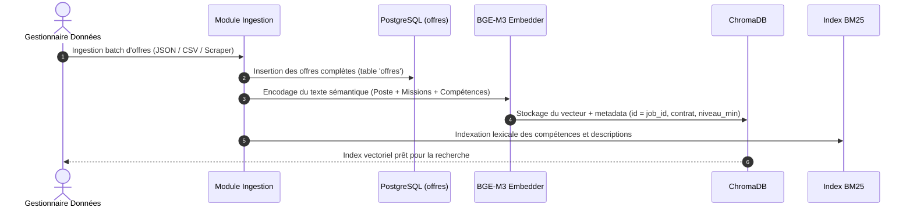
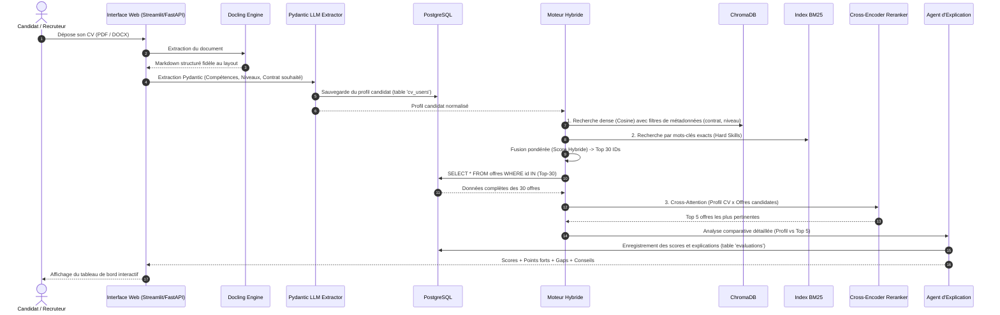

# Architecture Globale du Système
> Projet Master 2 IA — Recommandation automatisée d'offres d'emploi par analyse sémantique de CV

Ce document décrit l'architecture logicielle, les diagrammes de flux et le découpage modulaire du projet.

---

## 1. Diagramme d'Architecture de Haut Niveau

Le système est découpé en 4 couches interdépendantes :
1. **Couche d'Ingestion & Document AI** : Extraction multimodale et structuration.
2. **Couche de Persistance Hybride** : Données vectorielles (ChromaDB) et relationnelles (SQLite).
3. **Moteur de Matching à Deux Niveaux** : Filtrage dur + Recherche Hybride (Dense + BM25) + Reranking.
4. **Couche d'Explicabilité & Présentation** : Agent LLM d'évaluation et Interface Utilisateur (API + Web UI).

```mermaid
flowchart TD
    subgraph INGESTION["1. Couche d'Ingestion & Document AI"]
        CV_RAW["CV Candidat (PDF/DOCX)"] --> DOCLING["Docling Parser (Vision & Layout Analysis)"]
        DOCLING --> CV_MD["CV au format Markdown Hiérarchique"]
        CV_MD --> LLM_EXTRACT["Extracteur Structuré (LLM + Pydantic)"]
        LLM_EXTRACT --> CV_STRUCT["Profil JSON Structuré (Skills, Exp, Contrat...)"]
        
        JOB_SRC["Offres d'emploi brutes (Dataset / APIs)"] --> JOB_CLEAN["Nettoyeur & Formateur Markdown"]
        JOB_CLEAN --> JOB_STRUCT["Offres Structurées (Métadonnées + Texte)"]
    end

    subgraph STORAGE["2. Couche de Stockage Hybride (Dual Storage)"]
        CV_STRUCT -->|Enregistrement du profil| SQL_CV[("PostgreSQL: table cv_users\n- Profils structurés JSONB\n- Compétences TEXT[]\n- Parcours académique INT")]
        JOB_STRUCT -->|Enregistrement offre complète| SQL_JOB[("PostgreSQL: table offres\n- Détail complet des offres\n- Missions & Descriptions\n- Compétences requises")]
        
        JOB_STRUCT --> EMBEDDER["Runtime Ollama: bge-m3 (localhost:11434)"]
        EMBEDDER -->|Vector + Metadata (id = job_id)| CHROMA_DB[("ChromaDB (Index Vectoriel HNSW)\n- Embeddings des offres\n- Métadonnées de pré-filtrage")]
        JOB_STRUCT --> BM25_IDX["Index Lexical BM25"]
    end

    subgraph MATCHING["3. Moteur de Recherche Hybride & Reranking"]
        REQ["Requête Candidat (Profil + Embeddings)"] --> PRE_FILTER["Étape 1 : Pré-filtrage strict (ChromaDB Metadata & PostgreSQL)"]
        PRE_FILTER --> RETRIEVAL["Étape 2 : Ensemble Retriever\n- Similarité Cosinus (ChromaDB)\n- Score Lexical (BM25)"]
        RETRIEVAL --> TOP_CANDIDATES["Top-30 Offres candidates (IDs)"]
        TOP_CANDIDATES --> FETCH_SQL["Récupération offres complètes dans PostgreSQL"]
        FETCH_SQL --> RERANKER["Étape 3 : Cross-Encoder Reranker\n(bge-reranker-v2-m3)"]
        RERANKER --> TOP_FINAL["Top-5 Offres Rerankées"]
    end

    subgraph EXPLAIN["4. Agent d'Explicabilité & Restitution"]
        TOP_FINAL --> LLM_EXPLAIN["Agent d'Explicabilité (Ollama mistral:latest / LangChain)"]
        CV_STRUCT -.-> LLM_EXPLAIN
        LLM_EXPLAIN --> REPORT["Rapport de Matching Détaillé\n- Score d'adéquation (0-100%)\n- Points forts (Compétences validées)\n- Points de vigilance (Gaps)\n- Conseils de candidature"]
        LLM_EXPLAIN -->|Audit & Historique| SQL_MATCH[("PostgreSQL: table evaluations")]
        REPORT --> API_UI["Interface Utilisateur (React) / API FastAPI"]
    end

    CV_RAW --> REQ
    CHROMA_DB -.-> RETRIEVAL
    BM25_IDX -.-> RETRIEVAL
```

---

## 2. Flux de Traitement (Dataflow)

### 2.1 Ingestion et Vectorisation des Offres d'Emploi (Offline / Batch)


### 2.2 Recommandation en Temps Réel pour un Candidat (Online)


---

## 3. Structure Modulaire du Code Source Recommandée

Pour garantir un code propre, testable et maintenable conforme aux standards d'un projet de Master 2 IA :

```
Projet_CV/
├── docs/                      # Documentation complète du projet
│   ├── README.md              # Sommaire général
│   ├── ARCHITECTURE.md        # Architecture logicielle et flux
│   ├── TECH_STACK.md          # Justification des technologies
│   ├── PIPELINE_SPEC.md       # Spécification détaillée des étapes
│   ├── DATA_MODEL.md          # Schémas de données Pydantic et SQL
│   └── ROADMAP.md             # Feuille de route et métriques d'évaluation
├── data/                      # Stockage des données (non versionné sur git)
│   ├── raw_cvs/               # CVs bruts de test (PDF / DOCX)
│   ├── raw_jobs/              # Datasets d'offres (JSON / CSV)
│   ├── processed/             # CVs et offres transformés en Markdown
│   └── chromadb/              # Fichiers persistés de la base ChromaDB
├── src/                       # Code source de l'application
│   ├── __init__.py
│   ├── config.py              # Paramètres globaux (modèles, seuils, chemins)
│   ├── parsers/               # Module Document AI
│   │   ├── __init__.py
│   │   ├── docling_parser.py  # Wrapper Docling (PDF -> Markdown)
│   │   └── profile_extractor.py # Extraction structurée LLM + Pydantic
│   ├── database/              # Module persistance
│   │   ├── __init__.py
│   │   ├── sql_models.py      # Modèles SQLAlchemy (Candidat, Offre, Match)
│   │   ├── db_session.py      # Gestionnaire de session base relationnelle
│   │   └── vector_store.py    # Client ChromaDB & gestion des collections
│   ├── retrieval/             # Moteur de recherche et ranking
│   │   ├── __init__.py
│   │   ├── embeddings.py      # Initialisation des embeddings (bge-m3 / HuggingFace)
│   │   ├── bm25_search.py     # Index et recherche lexicale BM25
│   │   ├── hybrid_retriever.py# Moteur hybride (Combinaison Dense + BM25)
│   │   └── reranker.py        # Cross-Encoder (bge-reranker-v2-m3)
│   ├── agents/                # Agents d'intelligence et d'explication
│   │   ├── __init__.py
│   │   ├── explainability.py  # Analyse des gaps et justification du match
│   │   └── prompt_templates.py# Prompts système optimisés
│   ├── api/                   # Interface API REST
│   │   ├── __init__.py
│   │   └── main.py            # Endpoints FastAPI (/upload-cv, /recommend, etc.)
│   └── ui/                    # Interface de démonstration
│       └── app_streamlit.py   # Dashboard interactif Streamlit
├── tests/                     # Tests unitaires et d'intégration
│   ├── test_docling.py
│   ├── test_extractor.py
│   ├── test_retrieval.py
│   └── test_matching.py
├── notebooks/                 # Notebooks d'expérimentation et d'évaluation
│   ├── 01_docling_exploration.ipynb
│   ├── 02_hybrid_search_benchmark.ipynb
│   └── 03_evaluation_metrics.ipynb
├── pyproject.toml / requirements.txt
└── README.md                  # Guide de démarrage rapide du repo
```

---

## 4. Stratégie de Résilience & Performance

1. **Cache des extractions Docling** :
   - Le parsing par vision d'un PDF complexe peut prendre entre 1 et 3 secondes. Le système doit hacher le fichier (`sha256`) et cacher le résultat Markdown pour éviter les réextractions inutiles.
2. **Détection Dynamique du Matériel (GPU CUDA vs CPU)** :
   - Le système s'adapte automatiquement à l'environnement d'exécution via `settings.device` :
     - **Si GPU NVIDIA CUDA détecté** : Déport automatique des calculs tensoriels (BGE-M3, Cross-Encoder, vision Docling) sur CUDA pour une vitesse maximale.
     - **Si absence de GPU dédié (ex: machine de développement locale Intel)** : Bascule transparente et silencieuse sur le CPU sans plantage.
     - **Contrôle manuel** : Possibilité de surcharger ce comportement via `FORCE_DEVICE=cpu` ou `FORCE_DEVICE=cuda` dans le fichier `.env`.
3. **Explicabilité structurée** :
   - L'explicabilité ne doit pas être un simple texte libre : elle doit retourner une structure typée (score, compétences acquises vérifiées, compétences manquantes, arguments clés) facilement restituable dans une interface utilisateur.
