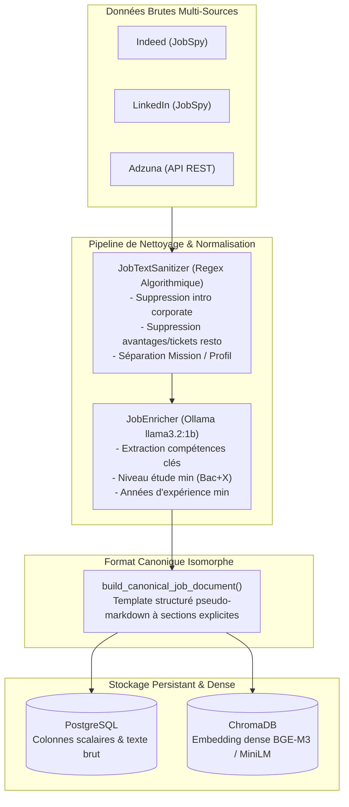
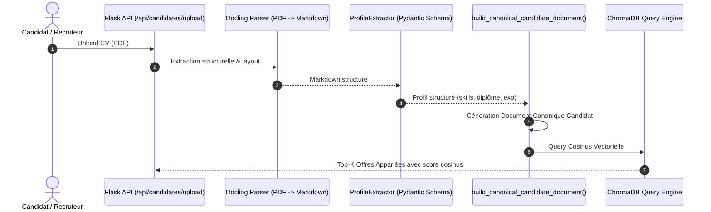

# Spécification Technique : Vectorisation Canonique Structurée & Indexation ChromaDB

> **Projet Master 2 IA** — Système de Recommandation d'Offres d'Emploi par Analyse Sémantique de CV  
> **Composant** : Pipeline d'Indexation Vectorielle (`src/pipeline/job_indexer.py`)  
> **Modèle d'Embedding** : Dense Embedding via Ollama (`bge-m3` ou `all-minilm`) — Vecteurs 384/1024 dims  
> **Base Vectorielle** : ChromaDB (`offres` collection) & PostgreSQL 16 (`projet_cv_db`)  

---

## 1. Problématique & Fondements Mathématiques

### 1.1. Métadonnées vs Texte Vectorisé (`document`) dans ChromaDB

Dans un moteur de recherche vectoriel comme ChromaDB :
* **Les Métadonnées (`metadatas`)** : Ne sont **JAMAIS** vectorisées par le modèle d'embedding. Elles servent uniquement de filtres booléens rigides (hard filters) dans la clause `where` (ex: `where={"secteur": "it_data", "is_active": True}`).
* **Le Document (`documents`)** : Est la **seule** chaîne textuelle projetée par le modèle d'embedding $E$ dans l'espace euclidien latent $\mathbb{R}^d$ :
  $$v = E(\text{document}) \in \mathbb{R}^d$$
* **Similarité Cosinus** : Le score de pertinence entre une requête $q$ (le CV candidat) et une offre $j$ (le job) repose exclusivement sur le produit scalaire normalisé de leurs vecteurs de document :
  $$\text{sim}(q, j) = \cos(\theta) = \frac{\mathbf{v}_q \cdot \mathbf{v}_j}{\|\mathbf{v}_q\|_2 \|\mathbf{v}_j\|_2}$$

> [!IMPORTANT]
> **Règle d'or de l'Embedding** : Tout élément sémantique critique pour le matching (intitulé, secteur, compétences clés, niveau d'études, expérience requise, missions, profil) **doit obligatoirement être présent dans le texte vectorisé**, sous peine d'être invisible pour la similarité cosinus.

---

### 1.2. Le Problème de l'Asymétrie Sémantique (Offre Prose vs CV Bullet Points)

Un CV de candidat en informatique est généralement synthétique, structuré en rubriques (titre, compétences techniques, formations, projets).  
À l'inverse, une offre brute scrapée sur le web présente :
1. **Du bruit textuel** : Présentations institutionnelles, packages salariaux, mutuelle, tickets restaurant (supprimés en amont par `JobTextSanitizer`).
2. **Une dispersion des compétences** : Les compétences clés sont noyées dans de longues phrases narratives.
3. **Une asymétrie stylistique** : Le modèle de langage dense (transformer) accorde de l'attention aux formulations stylistiques plutôt qu'aux équivalences réelles de compétences.

Pour maximiser la similarité cosinus et garantir une discrimination sémantique optimale, nous appliquons un **Format Canonique Isomorphe**.



---

## 2. Spécification du Format Canonique Structuré

Le template canonique est construit par la fonction `build_canonical_job_document(job: Offre)` dans [`src/pipeline/job_indexer.py`](file:///C:/MASTER2_IA/Projet_CV/src/pipeline/job_indexer.py).

### 2.1. Gabarit Standardisé

```text
[INTITULÉ DU POSTE] : {poste}
[ENTREPRISE] : {company} | [LIEU] : {location} | [CONTRAT] : {type_de_contrat}
[SECTEUR D'ACTIVITÉ] : {secteur}
[COMPÉTENCES TECHNIQUES CLÉS] : {competences_necessaires séparées par des virgules}
[NIVEAU D'ÉTUDES & EXPÉRIENCE] : Diplôme Bac+{niveau_etude_min} | Expérience minimale {min_experience_years} an(s)
[MISSIONS PRINCIPALES] :
{mission nettoyée}
[PROFIL RECHERCHÉ & QUALIFICATIONS] :
{description nettoyée}
```

### 2.2. Exemple Concret Vectorisé

Pour l'offre `job_15a0f84a9093` (Lead Data Engineer chez Capgemini) :

```text
[INTITULÉ DU POSTE] : Lead Data Engineer
[ENTREPRISE] : Capgemini | [LIEU] : Paris, France | [CONTRAT] : CDI
[SECTEUR D'ACTIVITÉ] : It Data
[COMPÉTENCES TECHNIQUES CLÉS] : Python, SQL, Spark, Kafka, AWS, Docker, CI/CD
[NIVEAU D'ÉTUDES & EXPÉRIENCE] : Diplôme Bac+5 | Expérience minimale 5.0 an(s)
[MISSIONS PRINCIPALES] :
- Concevoir et implémenter des architectures de données temps réel et batch.
- Encadrer une équipe de 5 data engineers et garantir les bonnes pratiques de code.
- Assurer le déploiement des pipelines sur l'infrastructure cloud AWS.
[PROFIL RECHERCHÉ & QUALIFICATIONS] :
- De formation supérieure en informatique (Bac+5 ou école d'ingénieurs).
- Solide expertise en streaming de données (Kafka, Spark Streaming).
- Expérience confirmée en leadership technique d'au moins 5 ans.
```

### 2.3. Avantages Théoriques du Gabarit
1. **Pondération sémantique naturelle** : Les tokens initiaux (`[INTITULÉ DU POSTE]`, `[COMPÉTENCES TECHNIQUES CLÉS]`) captent l'attention au début du contexte du transformer (primauté de position).
2. **Symétrie absolue avec le CV Candidat** : Le parseur de CV (Phase 2 : Docling + Pydantic) construira un document strictement calqué sur cette même nomenclature (`[INTITULÉ VISÉ]`, `[COMPÉTENCES TECHNIQUES CLÉS]`, `[EXPÉRIENCE GLOBALE]`). Le produit scalaire mesure alors l'alignement exact des descripteurs techniques.
3. **Zéro perte d'information narrative** : Les blocs `[MISSIONS PRINCIPALES]` et `[PROFIL RECHERCHÉ]` conservent la nuance du contexte métier sans la pollution du bruit contractuel.

---

## 3. Implémentation du Code Source

### 3.1. Génération du Document Canonique (`src/pipeline/job_indexer.py`)

```python
def build_canonical_job_document(job: Offre) -> str:
    """
    Construit la représentation textuelle canonique structurée d'une offre d'emploi.
    Optimise la similarité cosinus dans ChromaDB en assurant une symétrie parfaite
    avec le profil candidat extrait du CV (Docling + Pydantic).
    """
    skills_list = job.competences_necessaires or []
    skills_str = ", ".join(skills_list) if skills_list else "Non spécifié"

    diploma_level = int(job.niveau_etude_min or 0)
    diploma_str = f"Bac+{diploma_level}" if diploma_level > 0 else "Non spécifié"

    exp_years = float(job.min_experience_years or 0.0)
    exp_str = f"{exp_years:.1f} an(s)" if exp_years > 0.0 else "Débutant / Non spécifié"

    secteur_str = str(job.secteur or "it_data").replace("_", " ").title()

    lines = [
        f"[INTITULÉ DU POSTE] : {job.poste}",
        f"[ENTREPRISE] : {job.company} | [LIEU] : {job.location} | [CONTRAT] : {job.type_de_contrat}",
        f"[SECTEUR D'ACTIVITÉ] : {secteur_str}",
        f"[COMPÉTENCES TECHNIQUES CLÉS] : {skills_str}",
        f"[NIVEAU D'ÉTUDES & EXPÉRIENCE] : Diplôme {diploma_str} | Expérience minimale {exp_str}",
    ]

    clean_mission = (job.mission or "").strip()
    clean_desc = (job.description or "").strip()

    if clean_mission:
        lines.append(f"[MISSIONS PRINCIPALES] :\n{clean_mission}")

    if clean_desc and clean_desc != clean_mission:
        lines.append(f"[PROFIL RECHERCHÉ & QUALIFICATIONS] :\n{clean_desc}")
    elif not clean_mission and clean_desc:
        lines.append(f"[DESCRIPTION DU POSTE] :\n{clean_desc}")

    return "\n".join(lines)
```

### 3.2. Ré-indexation Globale dans ChromaDB (`reindex_all_jobs`)

```python
def reindex_all_jobs(self) -> int:
    """
    Re-vectorise TOUTES les offres de PostgreSQL dans ChromaDB
    avec le format canonique structuré et les textes nettoyés.
    """
    db = SessionLocal()
    try:
        all_jobs = db.query(Offre).filter(Offre.is_active == True).all()
        if not all_jobs:
            return 0

        with tqdm(total=len(all_jobs), desc="🔄 Ré-indexation ChromaDB", unit="offre") as pbar:
            for i in range(0, len(all_jobs), self.batch_size):
                batch = all_jobs[i:i + self.batch_size]
                ids = [job.id for job in batch]
                documents = [build_canonical_job_document(job) for job in batch]
                metadatas = [
                    {
                        "poste": job.poste,
                        "company": job.company,
                        "location": job.location,
                        "source": job.source or "unknown",
                        "secteur": job.secteur or "it_data",
                        "date_posted": str(job.date_posted) if job.date_posted else "",
                        "type_de_contrat": job.type_de_contrat,
                        "niveau_etude_min": int(job.niveau_etude_min),
                        "is_active": True,
                    }
                    for job in batch
                ]
                self.collection.upsert(ids=ids, documents=documents, metadatas=metadatas)
                for job in batch:
                    job.is_indexed = True
                    job.indexed_at = datetime.now(timezone.utc)
                db.commit()
                pbar.update(len(batch))

        return len(all_jobs)
    finally:
        db.close()
```

---

## 4. Endpoints REST Associés (`src/api/routes.py`)

| Méthode | Route | Rôle & Paramètres | Exemple Réponse |
| :--- | :--- | :--- | :--- |
| `POST` | `/api/jobs/reindex` | Ré-indexe l'intégralité des offres actives de PostgreSQL dans ChromaDB avec le format canonique. | `{"status": "success", "total_indexed": 102}` |
| `POST` | `/api/jobs/enrich-pending` | Enrichit les offres non enrichies (colonnes vides) via Ollama `llama3.2:1b`. Body : `{"limit": 5}` | `{"status": "success", "enriched_count": 5}` |
| `POST` | `/api/jobs/search-vector` | Recherche sémantique par similarité cosinus. Body : `{"query": "Data Engineer Spark AWS", "n_results": 5}` | `{"query": "...", "count": 5, "results": [...]}` |

---

## 5. Guide d'Exécution & Commandes Utilisateur

### Étape 1 : Démarrer l'API Flask (Terminal 1)
```powershell
python main.py
```

### Étape 2 : Ré-indexer la base ChromaDB (Terminal 2)
Cette commande recalcule l'intégralité des embeddings des 102 offres en base avec le template canonique :
```powershell
Invoke-RestMethod -Uri "http://127.0.0.1:5000/api/jobs/reindex" -Method Post -TimeoutSec 600
```

### Étape 3 : Tester la similarité cosinus avec une requête canonique (Terminal 2)
```powershell
Invoke-RestMethod -Uri "http://127.0.0.1:5000/api/jobs/search-vector" `
  -Method Post `
  -ContentType "application/json" `
  -Body '{"query": "Ingénieur Data Cloud Python Spark AWS Bac+5", "n_results": 3}'
```

---

## 6. Alignement avec la Phase 2 (Ingestion de CV Candidat)

Lors de la Phase 2 du projet, le module d'ingestion de CV appliquera une symétrie parfaite :



Grâce à cette projection canonique conjointe, la métrique cosinus opère à iso-structure, éliminant les biais de syntaxe et garantissant un matching explicable de haute précision.
