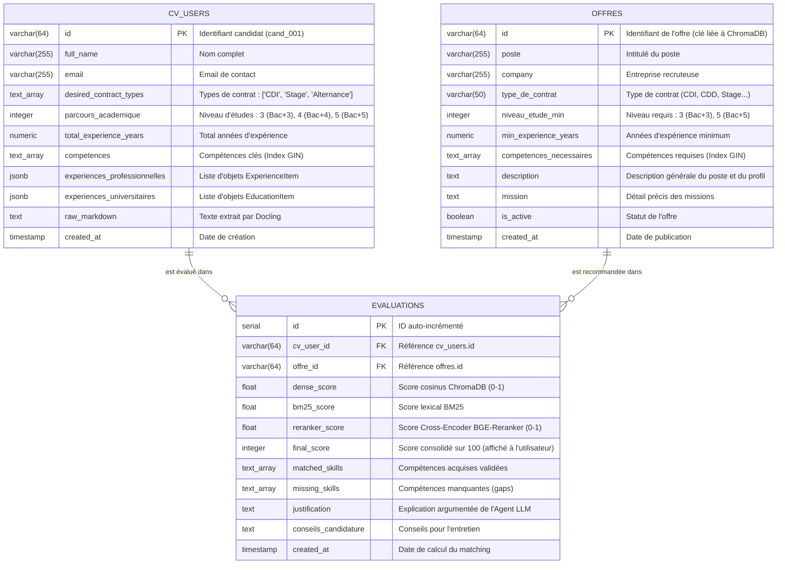

# Modèle de Données & Schémas
> Projet Master 2 IA — Spécification des schémas Pydantic, SQL et ChromaDB

Ce document formalise les structures de données manipulées dans l'ensemble du système.

---

## 1. Schémas Pydantic (Validation & Extraction LLM)

### 1.1 Profil Candidat (`CandidateProfile`)

```python
from datetime import date
from typing import List, Optional
from pydantic import BaseModel, EmailStr, Field


class ExperienceItem(BaseModel):
    title: str = Field(description="Intitulé du poste occupé")
    company: Optional[str] = Field(None, description="Nom de l'entreprise ou organisation")
    start_date: Optional[str] = Field(None, description="Date de début (ex: 2023, Janvier 2022)")
    end_date: Optional[str] = Field(None, description="Date de fin ou 'Présent'")
    is_current: bool = Field(False, description="Poste actuel ou non")
    description: str = Field(description="Missions et réalisations principales")
    technologies_used: List[str] = Field(default_factory=list, description="Outils et technologies mobilisés")


class EducationItem(BaseModel):
    degree: str = Field(description="Nom du diplôme ou de la formation (ex: Master 2 IA, Licence Info)")
    institution: Optional[str] = Field(None, description="Établissement ou université")
    year: Optional[str] = Field(None, description="Année d'obtention ou de promotion")
    field_of_study: Optional[str] = Field(None, description="Domaine d'études (ex: Data Science, Mathématiques)")


class CandidateProfile(BaseModel):
    id: Optional[str] = Field(None, description="Identifiant unique du candidat (ex: cand_001)")
    full_name: str = Field(description="Nom complet du candidat")
    email: Optional[str] = Field(None, description="Adresse email de contact")
    phone: Optional[str] = Field(None, description="Numéro de téléphone")
    location: Optional[str] = Field(None, description="Ville ou région de résidence")
    
    target_role: str = Field(description="Intitulé de poste ciblé par le candidat")
    total_experience_years: float = Field(0.0, description="Années d'expérience professionnelle cumulées")
    parcours_academique: int = Field(5, description="Niveau d'études le plus élevé : 3 (Bac+3), 4 (Bac+4), 5 (Bac+5/Master/Ingénieur), 8 (Doctorat)")
    
    # Compétences
    competences: List[str] = Field(default_factory=list, description="Liste globale de compétences techniques et métiers")
    programming_languages: List[str] = Field(default_factory=list, description="Langages (Python, C++, SQL...)")
    frameworks_and_libs: List[str] = Field(default_factory=list, description="Frameworks (PyTorch, LangChain, React...)")
    cloud_and_devops: List[str] = Field(default_factory=list, description="Outils Cloud/DevOps (Docker, AWS, Git...)")
    soft_skills: List[str] = Field(default_factory=list, description="Compétences comportementales")
    spoken_languages: List[str] = Field(default_factory=list, description="Langues maîtrisées")
    
    experiences: List[ExperienceItem] = Field(default_factory=list, description="Historique des expériences professionnelles (stocké en JSONB dans cv_users)")
    educations: List[EducationItem] = Field(default_factory=list, description="Historique académique et diplômes (stocké en JSONB dans cv_users)")
    
    # Critères de recherche pour le matching
    desired_contract_types: List[str] = Field(default_factory=list, description="Types de contrat recherchés : ['CDI', 'Stage', 'Alternance']")
    remote_preference: Optional[str] = Field(None, description="Ex: 'Full remote', 'Hybride', 'Sur site'")
    raw_markdown: Optional[str] = Field(None, description="Texte brut extrait par Docling")


---

### 1.2 Offre d'Emploi (`JobOffer`)

```python
class JobOffer(BaseModel):
    id: str = Field(description="Identifiant unique de l'offre (clé primaire et ID ChromaDB)")
    poste: str = Field(description="Intitulé du poste recherché (ex: 'Data Scientist NLP')")
    company: str = Field(description="Entreprise qui recrute")
    location: str = Field(description="Ville ou pays (ex: Paris, Lyon, Remote)")
    type_de_contrat: str = Field(description="Type de contrat : CDI, CDD, Stage, Alternance, Freelance")
    remote_policy: Optional[str] = Field("Non spécifié", description="Sur site, Hybride, Full remote")
    
    niveau_etude_min: int = Field(0, description="Niveau d'études minimum requis : 0 (indifférent), 3 (Bac+3), 4 (Bac+4), 5 (Bac+5)")
    min_experience_years: float = Field(0.0, description="Nombre minimum d'années d'expérience requises")
    
    competences_necessaires: List[str] = Field(default_factory=list, description="Compétences impératives / indispensables")
    nice_to_have_skills: List[str] = Field(default_factory=list, description="Compétences secondaires / souhaitées")
    
    missions: str = Field(description="Descriptif détaillé des missions")
    description: str = Field(description="Description générale de l'offre et du profil recherché")
    raw_text: Optional[str] = Field(None, description="Texte complet brut de l'annonce")
    
    publication_date: Optional[str] = Field(None, description="Date de publication")
    source_url: Optional[str] = Field(None, description="Lien vers l'offre d'origine")
```

---

### 1.3 Évaluation et Recommandation (`MatchEvaluation`)

```python
class MatchEvaluation(BaseModel):
    job_id: str
    job_title: str
    company: str
    
    dense_score: float = Field(description="Score de similarité vectorielle (0.0 à 1.0)")
    bm25_score: float = Field(description="Score lexical BM25")
    reranker_score: float = Field(description="Score retourné par le Cross-Encoder (0.0 à 1.0)")
    final_score: int = Field(description="Score final consolidé sur 100")
    
    match_status: str = Field(description="Catégorie : 'Match idéal', 'Bon match', 'Reconversion / À développer'")
    matched_skills: List[str] = Field(description="Compétences de l'offre validées par le CV")
    missing_skills: List[str] = Field(description="Compétences de l'offre absentes ou insuffisantes")
    justification: str = Field(description="Explication détaillée de la décision du modèle")
    recommendations_for_candidate: str = Field(description="Conseils pour optimiser la candidature")
```

---

## 2. Métadonnées Vectorielles (ChromaDB)

## 2. Métadonnées Vectorielles (ChromaDB)

Dans ChromaDB, chaque document représente une offre d'emploi (ou un chunk d'offre si découpée).
L'indexation vectorielle stocke l'identifiant, le texte d'embedding et les métadonnées de pré-filtrage strict (types supportés : `str`, `int`, `float`, `bool`).

### Alignement Clé :
* **`id` dans ChromaDB** = `id` dans la table PostgreSQL `offres` (ex: `"job_042"` ou `"job_042_chunk_0"`).
* Permet de faire la recherche vectorielle dans ChromaDB, puis de récupérer instantanément les données complètes dans PostgreSQL avec `WHERE id IN (...)`.

### Structure d'un enregistrement ChromaDB :
```python
{
    "id": "job_042",
    "document": (
        "Poste: Ingénieur RAG & NLP | Entreprise: TechSolutions | Contrat: CDI | Niveau min: Bac+5\n"
        "Compétences clés: Python, LangChain, PyTorch, ChromaDB, Docker, PostgreSQL\n"
        "Missions: Conception d'architectures RAG scalables, ingestion de flux de documents, optimisation d'embeddings...\n"
        "Profil: Diplômé Bac+5 avec solide appétence pour le NLP et les architectures hybrides."
    ),
    "metadata": {
        "job_id": "job_042",
        "poste": "Ingénieur RAG & NLP",
        "company": "TechSolutions",
        "type_de_contrat": "CDI",
        "niveau_etude_min": 5,           # Permet le filtre: $lte (inférieur ou égal au bac du candidat)
        "min_experience_years": 2.0,     # Permet le filtre: $lte (inférieur ou égal à l'expérience candidat)
        "is_active": True
    }
}
```

---

## 3. Schéma Relationnel SQL (PostgreSQL & SQLAlchemy)

PostgreSQL fait office de **Source Unique de Vérité (SSOT)**. Il stocke l'intégralité des données structurées des profils candidats, des offres d'emploi complètes et l'historique d'évaluation/matching.

> [!TIP]
> **Pourquoi stocker `dense_score`, `bm25_score` et `reranker_score` alors que l'interface n'affiche que `final_score` ?**
> 1. **Expérience Utilisateur (UI)** : L'utilisateur final ne voit qu'une liste triée avec son `final_score` (ex: 88%) et une explication claire. Les scores bruts ne polluent pas l'interface.
> 2. **Débogage & Auditabilité** : Si une offre est mal classée, ces 3 scores permettent d'isoler immédiatement si le problème vient de l'embedding (dense), des mots-clés (lexical) ou du Cross-Encoder (reranker).
> 3. **Ablation Study (Master 2 IA)** : Indispensable pour la soutenance académique, cela permet de comparer scientifiquement en une requête SQL la précision avec Embedding seul vs Hybride vs Reranker.
> 4. **Calibrage des poids sans recalcul GPU** : Si la formule de pondération évolue, il suffit d'un `UPDATE evaluations SET final_score = ...` sans ré-exécuter les modèles d'IA.

### 3.1 Diagramme Entité-Relation (ERD)



### 3.2 Script DDL PostgreSQL (Création des Tables & Index)

```sql
-- Extension pour fonctions utiles
CREATE EXTENSION IF NOT EXISTS "uuid-ossp";

-- Table des Candidats (CVs)
CREATE TABLE cv_users (
    id VARCHAR(64) PRIMARY KEY,
    full_name VARCHAR(255) NOT NULL,
    email VARCHAR(255),
    desired_contract_types VARCHAR(50)[] NOT NULL DEFAULT '{}',
    parcours_academique INTEGER NOT NULL DEFAULT 5, -- 3 (Bac+3), 4 (Bac+4), 5 (Bac+5)
    total_experience_years NUMERIC(4, 1) DEFAULT 0.0,
    competences TEXT[] NOT NULL DEFAULT '{}',
    experiences_professionnelles JSONB DEFAULT '[]'::jsonb,
    experiences_universitaires JSONB DEFAULT '[]'::jsonb,
    raw_markdown TEXT,
    created_at TIMESTAMP WITH TIME ZONE DEFAULT CURRENT_TIMESTAMP
);

-- Table des Offres d'emploi
CREATE TABLE offres (
    id VARCHAR(64) PRIMARY KEY,
    poste VARCHAR(255) NOT NULL,
    company VARCHAR(255) NOT NULL,
    type_de_contrat VARCHAR(50) NOT NULL,
    niveau_etude_min INTEGER DEFAULT 0,            -- 0 (indifférent), 3 (Bac+3), 5 (Bac+5)
    min_experience_years NUMERIC(4, 1) DEFAULT 0.0,
    competences_necessaires TEXT[] NOT NULL DEFAULT '{}',
    description TEXT NOT NULL,
    mission TEXT NOT NULL,
    is_active BOOLEAN DEFAULT TRUE,
    created_at TIMESTAMP WITH TIME ZONE DEFAULT CURRENT_TIMESTAMP
);

-- Table des Évaluations de Matching (Relation N:M, Explicabilité & Audit)
CREATE TABLE evaluations (
    id SERIAL PRIMARY KEY,
    cv_user_id VARCHAR(64) NOT NULL REFERENCES cv_users(id) ON DELETE CASCADE,
    offre_id VARCHAR(64) NOT NULL REFERENCES offres(id) ON DELETE CASCADE,
    dense_score FLOAT,                            -- Score cosinus dense (ChromaDB)
    bm25_score FLOAT,                             -- Score lexical BM25
    reranker_score FLOAT,                         -- Score Cross-Encoder
    final_score INTEGER NOT NULL,                 -- Score final (0-100) pour l'affichage UI
    matched_skills TEXT[] DEFAULT '{}',
    missing_skills TEXT[] DEFAULT '{}',
    justification TEXT,
    conseils_candidature TEXT,
    created_at TIMESTAMP WITH TIME ZONE DEFAULT CURRENT_TIMESTAMP,
    CONSTRAINT unique_cv_offre UNIQUE (cv_user_id, offre_id)
);

-- Index pour optimiser les performances des filtres stricts et recherches
CREATE INDEX idx_cv_competences ON cv_users USING GIN(competences);
CREATE INDEX idx_cv_experiences_pro ON cv_users USING GIN(experiences_professionnelles);
CREATE INDEX idx_offres_competences ON offres USING GIN(competences_necessaires);
CREATE INDEX idx_offres_contrat_etude ON offres (type_de_contrat, niveau_etude_min);
CREATE INDEX idx_eval_user_score ON evaluations (cv_user_id, final_score DESC);
CREATE INDEX idx_eval_offre_score ON evaluations (offre_id, final_score DESC);
```
