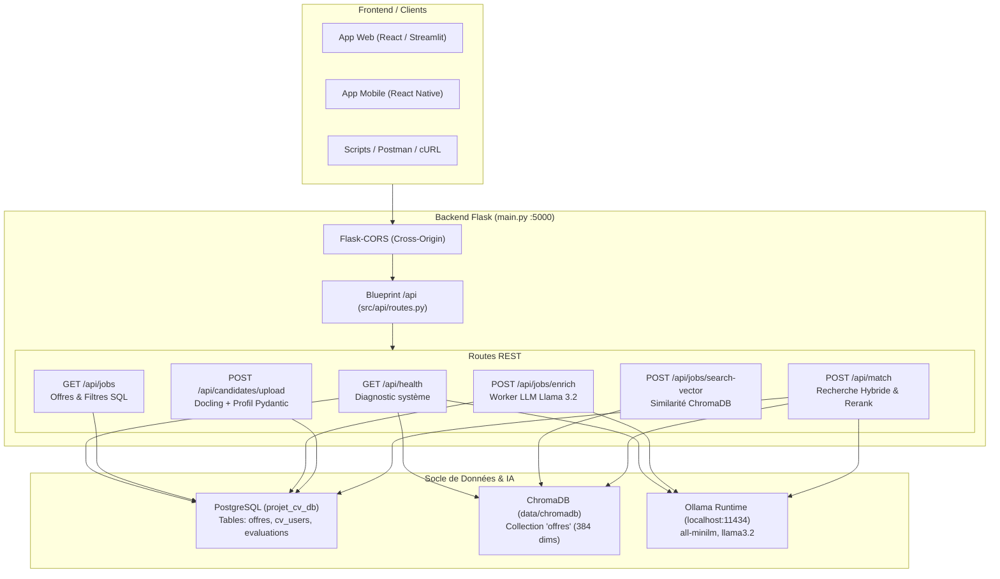

# Spécification & Guide d'Implémentation : Serveur Backend Flask
> **Projet Master 2 IA** — Système de Recommandation d'Offres d'Emploi par Analyse Sémantique de CV  
> **Composant** : API REST Flask (Blueprints, CORS, Connexion PostgreSQL, ChromaDB & Ollama)  
> **Architecture** : Modulaire et découplée (alignée avec les standards de cours M2 IA)  
> **Point d'entrée** : `main.py` (racine du projet)

---

## 1. Vue d'Ensemble de l'Architecture Backend

Le serveur Flask agit comme le chef d'orchestre central de votre application. Il expose les points de terminaison REST (Endpoints) permettant à une interface utilisateur (React, React Native, Streamlit ou Vue.js) d'interagir avec vos modules IA.



---

## 2. Organisation des Fichiers

```
Projet_CV/
├── main.py                     # Point d'entrée exécutable (app.run)
├── requirements.txt            # Dépendances (avec flask et flask-cors)
├── docs/
│   └── FLASK_BACKEND_SPEC.md   # Cette documentation
└── src/
    ├── api/
    │   ├── __init__.py
    │   └── routes.py           # Blueprint API REST et gestionnaires de requêtes
    ├── database/               # PostgreSQL & ChromaDB
    ├── parsers/                # JobEnricher, Docling, ProfileExtractor
    ├── pipeline/               # Ingestion, Déduplication, Indexation
    └── utils/                  # OllamaClient
```

---

## 3. Matrice des Endpoints REST

| Méthode | Route | Rôle & Entrée | Sortie / Réponse JSON |
| :--- | :--- | :--- | :--- |
| `GET` | `/api/health` | Vérifie l'état de PostgreSQL, ChromaDB et Ollama. | `{"status": "ok", "postgres": true, "chroma_vectors": 60, "ollama": true}` |
| `GET` | `/api/jobs` | Liste les offres avec filtres : `?source=indeed&limit=20&page=1`. | `{"total": 60, "jobs": [...]}` |
| `GET` | `/api/jobs/<job_id>` | Récupère le détail complet d'une offre spécifique. | `{"id": "job_...", "poste": "...", "competences_necessaires": [...]}` |
| `POST` | `/api/jobs/search-vector` | Recherche sémantique par texte ou compétences : `{"query": "Data Scientist NLP", "top_k": 5}`. | `{"results": [{"job_id": "...", "cosine_similarity": 0.82, ...}]}` |
| `POST` | `/api/jobs/enrich/<job_id>` | Déclenche l'enrichissement IA Llama 3.2 sur une offre ciblée. | `{"success": true, "job_id": "...", "competences": [...]}` |
| `POST` | `/api/jobs/ingest` | Déclenche une collecte d'offres : `{"source": "indeed", "query": "IA", "limit": 10}`. | `{"saved": 10, "duplicates": 2}` |

---

## 4. Guide d'Installation des Dépendances

Ajouter les bibliothèques Web dans `requirements.txt` :
```
flask>=3.0.0
flask-cors>=4.0.0
```

Commande d'installation dans le terminal :
```powershell
pip install flask flask-cors
```

---

## 5. Exécution & Test du Serveur

### Lancement du serveur en local :
```powershell
python main.py
```
Le serveur démarrera sur **`http://127.0.0.1:5000`** (ou `http://localhost:5000`).

### Tests rapides via cURL ou Navigateur :
1. **Healthcheck** :
   Ouvrez simplement dans votre navigateur :  
   👉 `http://localhost:5000/api/health`

2. **Consulter les offres d'emploi** :  
   👉 `http://localhost:5000/api/jobs?limit=5`

3. **Recherche sémantique vectorielle via PowerShell** :
   ```powershell
   Invoke-RestMethod -Uri http://localhost:5000/api/jobs/search-vector -Method Post -Body '{"query": "Machine Learning Python PyTorch", "top_k": 3}' -ContentType "application/json"
   ```
