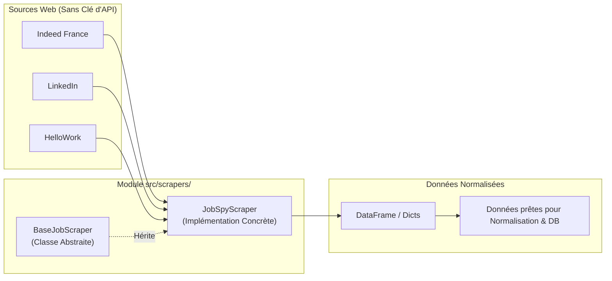

# Guide d'Implémentation du Scraper Multi-Sources JobSpy
> Projet Master 2 IA — Recommandation d'offres d'emploi par analyse de CV  
> Composant : Ingestion des offres (`src/scrapers/`)

Ce document détaille l'architecture, le code de production et la procédure de test pour scraper les offres d'emploi réelles (**LinkedIn**, **Indeed**, **HelloWork**) sans clé d'API grâce à la bibliothèque **JobSpy**.

---

## 1. Vue d'Ensemble & Position dans le Système



### Pourquoi JobSpy est la solution idéale pour le projet :
1. **0 Clé d'API & 0 Inscription** : Fonctionne immédiatement sans démarche administrative.
2. **Couverture France** : Supporte **Indeed** (avec `country_indeed="france"`), **LinkedIn** et **HelloWork** (plateforme n°1 en France).
3. **Format Markdown natif** : Le paramètre `description_format="markdown"` extrait les annonces directement au format Markdown, parfaitement compatible avec le reste de notre pipeline IA.

---

## 2. Table de Mapping : JobSpy ➔ Notre Schéma de Données

Le résultat de JobSpy retourne un DataFrame Pandas avec des colonnes standardisées qu'il faut mapper vers les champs attendus par notre table PostgreSQL [`offres`](file:///C:/MASTER2_IA/Projet_CV/docs/DATA_MODEL.md) :

| Champ JobSpy | Champ Projet (`offres`) | Règle de transformation / Fallback |
| :--- | :--- | :--- |
| `title` | `poste` | Titre du poste (obligatoire) |
| `company` | `company` | Nom de l'entreprise (ou `"Entreprise non spécifiée"`) |
| `location` / `city` | `location` | Ville ou région (ex: `"Paris, France"`) |
| `job_type` | `type_de_contrat` | Normalisation : `fulltime` ➔ `CDI`, `internship` ➔ `Stage`, `contract` ➔ `CDD / Prestation`, etc. |
| `description` | `description` / `mission` | Description au format Markdown préservant les puces et titres |
| `job_url` | `source_url` | Lien web direct vers l'annonce d'origine |
| `is_remote` | `remote_policy` | Booléen converti en : `Télétravail` si True, `Sur site / Hybride` sinon |
| `site` | `source_platform` | Provenance de l'offre (`indeed`, `linkedin`, `hellowork`) |

---

## 3. Code Source Complet & Prêt à l'Emploi

### 3.1 Classe de base abstraite : `src/scrapers/base_scraper.py`

Ce fichier définit le contrat que **tous** les scrapers (JobSpy, Adzuna, France Travail si activé plus tard) doivent respecter :

```python
"""
src/scrapers/base_scraper.py
Classe de base abstraite unifiant tous les scrapers d'offres d'emploi.
"""

from abc import ABC, abstractmethod
from typing import List, Dict, Any, Optional


class BaseJobScraper(ABC):
    """
    Interface abstraite pour la collecte d'offres d'emploi.
    Garantit l'interchangeabilité des sources dans le pipeline d'ingestion.
    """

    def __init__(self, name: str):
        self.name = name

    @abstractmethod
    def search_jobs(
        self,
        query: str,
        location: str = "France",
        limit: int = 20,
        **kwargs: Any
    ) -> List[Dict[str, Any]]:
        """
        Recherche et retourne une liste de dictionnaires représentant des offres brutes.

        Args:
            query (str): Mots-clés de recherche (ex: "Data Scientist", "Ingénieur IA").
            location (str): Localisation cible (ex: "Paris", "France", "Lyon").
            limit (int): Nombre maximum de résultats souhaités.
            **kwargs: Paramètres additionnels spécifiques au scraper.

        Returns:
            List[Dict[str, Any]]: Liste des offres au format brut standardisé.
        """
        pass
```

---

### 3.2 Implémentation JobSpy : `src/scrapers/jobspy_scraper.py`

Ce fichier implémente l'appel concurrentiel aux plateformes avec gestion d'erreurs, normalisation des types de contrats et nettoyage :

```python
"""
src/scrapers/jobspy_scraper.py
Connecteur multi-plateformes utilisant python-jobspy (Indeed, LinkedIn, HelloWork).
"""

import logging
from typing import List, Dict, Any, Optional
import pandas as pd
from jobspy import scrape_jobs

from src.scrapers.base_scraper import BaseJobScraper

logger = logging.getLogger(__name__)


# Dictionnaire de correspondance des contrats anglo-saxons vers le droit français
CONTRACT_MAPPING = {
    "fulltime": "CDI",
    "parttime": "Temps partiel",
    "internship": "Stage",
    "contract": "CDD / Freelance",
    "temporary": "Intérim",
}


class JobSpyScraper(BaseJobScraper):
    """
    Scraper robuste exploitant python-jobspy pour agréger LinkedIn, Indeed et HelloWork.
    """

    def __init__(
        self,
        sites: Optional[List[str]] = None,
        country_indeed: str = "france",
    ):
        super().__init__(name="JobSpy")
        # Par défaut, on cible Indeed et LinkedIn (les deux plus riches en tech/IA)
        self.sites = sites or ["indeed", "linkedin"]
        self.country_indeed = country_indeed

    def _normalize_contract_type(self, raw_type: Optional[str]) -> str:
        """Convertit les types de contrats JobSpy en termes français standard."""
        if not raw_type or pd.isna(raw_type):
            return "Non spécifié"
        clean_type = str(raw_type).strip().lower()
        return CONTRACT_MAPPING.get(clean_type, clean_type.capitalize())

    def search_jobs(
        self,
        query: str,
        location: str = "France",
        limit: int = 15,
        hours_old: Optional[int] = 168,  # 7 derniers jours par défaut
        fetch_description: bool = True,
        **kwargs: Any
    ) -> List[Dict[str, Any]]:
        """
        Récupère les offres d'emploi sur les plateformes configurées.

        Args:
            query (str): Intitulé du poste ou mots-clés (ex: "Machine Learning").
            location (str): Ville ou pays (ex: "Paris", "France").
            limit (int): Nombre d'offres souhaité par site.
            hours_old (int, optionnel): Offres publiées dans les N dernières heures.
            fetch_description (bool): Forcer la récupération du corps complet en Markdown.

        Returns:
            List[Dict[str, Any]]: Liste d'offres normalisées.
        """
        logger.info(
            f"🔍 Lancement scraping JobSpy | Sites={self.sites} | Query='{query}' | Location='{location}' | Limit={limit}"
        )

        try:
            jobs_df: pd.DataFrame = scrape_jobs(
                site_name=self.sites,
                search_term=query,
                location=location,
                country_indeed=self.country_indeed,
                results_wanted=limit,
                hours_old=hours_old,
                description_format="markdown",
                fetch_description=fetch_description,
                verbose=0,
                **kwargs
            )
        except Exception as e:
            logger.error(f"❌ Erreur critique lors de l'appel à scrape_jobs: {e}")
            return []

        if jobs_df is None or jobs_df.empty:
            logger.warning("⚠️ Aucune offre trouvée par JobSpy pour ces critères.")
            return []

        results: List[Dict[str, Any]] = []

        for _, row in jobs_df.iterrows():
            title = str(row.get("title", "")).strip()
            description = str(row.get("description", "")).strip()

            # On ignore les offres sans titre ou sans description exploitable
            if not title or len(description) < 30:
                continue

            company = str(row.get("company", "Entreprise confidentielle")).strip()
            job_location = str(row.get("location", location)).strip()
            contract_type = self._normalize_contract_type(row.get("job_type"))
            is_remote = bool(row.get("is_remote", False))
            job_url = str(row.get("job_url", "")).strip()
            site_source = str(row.get("site", "web")).strip()

            raw_item = {
                "source": site_source,
                "external_id": str(row.get("id", "")),
                "poste": title,
                "company": company,
                "location": job_location,
                "type_de_contrat": contract_type,
                "remote_policy": "Télétravail" if is_remote else "Sur site / Hybride",
                "description": description,
                "source_url": job_url,
                "date_posted": str(row.get("date_posted", "")),
            }
            results.append(raw_item)

        logger.info(f"✅ Scraping terminé avec succès : {len(results)} offres exploitables retenues.")
        return results
```

---

### 3.3 Script de test autonome : `tests/test_jobspy.py`

Ce test interroge le web en direct sur la requête `"Data Scientist"` à `"Paris"` et affiche les 3 premières offres collectées :

```python
"""
tests/test_jobspy.py
Script de vérification du scraper JobSpy en direct.
"""

import sys
from pathlib import Path

# Résolution des imports depuis la racine du projet
sys.path.insert(0, str(Path(__file__).resolve().parent.parent))

# Résolution de l'encodage pour le terminal Windows (PowerShell/CMD)
if hasattr(sys.stdout, "reconfigure"):
    sys.stdout.reconfigure(encoding="utf-8")

from src.scrapers.jobspy_scraper import JobSpyScraper


def main():
    print("=" * 65)
    print("🚀 TEST DE SCRAPING MULTI-SOURCES : JobSpy (Indeed & LinkedIn)")
    print("=" * 65)

    # 1. Initialisation du scraper
    scraper = JobSpyScraper(sites=["indeed", "linkedin"], country_indeed="france")

    # 2. Exécution d'une recherche test
    query = "Data Scientist"
    location = "Paris"
    limit = 3

    print(f"\n[1/2] Lancement de la recherche...")
    print(f"      Mot-clé   : '{query}'")
    print(f"      Lieu      : '{location}'")
    print(f"      Nb offres : {limit} par source")

    jobs = scraper.search_jobs(query=query, location=location, limit=limit)

    print(f"\n[2/2] Analyse des résultats récupérés : {len(jobs)} offres trouvées.")

    if not jobs:
        print("❌ Aucune offre récupérée. Vérifiez votre connexion Internet.")
        return

    # 3. Affichage détaillé des 3 premières offres
    for i, job in enumerate(jobs[:3], 1):
        print("\n" + "-" * 50)
        print(f"📄 Offre #{i} | Source : {job['source'].upper()}")
        print(f"📌 Poste      : {job['poste']}")
        print(f"🏢 Entreprise : {job['company']}")
        print(f"📍 Lieu       : {job['location']}")
        print(f"📋 Contrat    : {job['type_de_contrat']} ({job['remote_policy']})")
        print(f"🔗 URL        : {job['source_url']}")
        desc_preview = job['description'][:180].replace("\n", " ")
        print(f"📝 Extrait    : {desc_preview}...")

    print("\n" + "=" * 65)
    print("🎉 SUCCÈS : Le connecteur JobSpy fonctionne parfaitement !")
    print("=" * 65)


if __name__ == "__main__":
    main()
```

---

## 4. Procédure d'Exécution & Vérification

### Étape 1 : Mettre à jour les fichiers de code
Vous pouvez copier le code ci-dessus dans les 3 fichiers respectifs :
1. [`src/scrapers/base_scraper.py`](file:///C:/MASTER2_IA/Projet_CV/src/scrapers/base_scraper.py)
2. [`src/scrapers/jobspy_scraper.py`](file:///C:/MASTER2_IA/Projet_CV/src/scrapers/jobspy_scraper.py)
3. [`tests/test_jobspy.py`](file:///C:/MASTER2_IA/Projet_CV/tests/test_jobspy.py)

### Étape 2 : Lancer le test dans le terminal
Exécutez dans votre terminal PowerShell :
```powershell
python tests/test_jobspy.py
```

### Étape 3 : Résultat attendu
Le terminal va contacter Indeed et LinkedIn en tâche de fond et afficher les annonces récupérées avec leurs descriptions au format Markdown.
