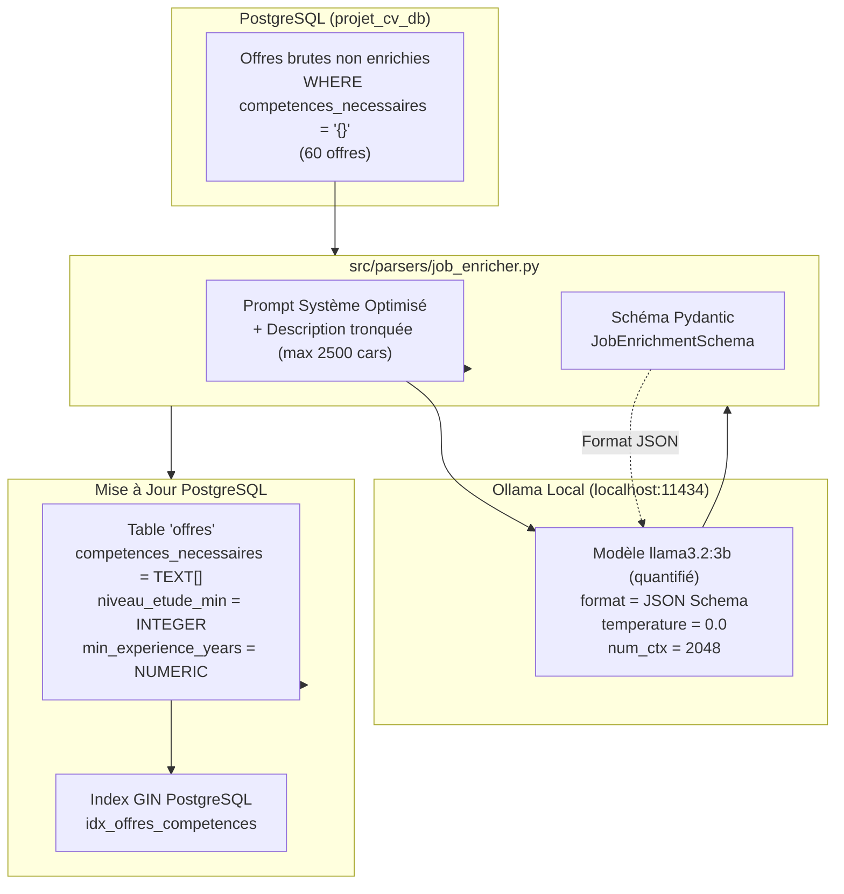

# Spécification Technique : Enrichissement des Offres par LLM Local (Ollama + Pydantic)
> **Projet Master 2 IA** — Système de Recommandation d'Offres d'Emploi par Analyse Sémantique de CV  
> **Composant** : Worker d'Extraction Structurée de Compétences et Critères Recruteur  
> **Runtime IA** : Ollama Local (`localhost:11434`) avec `llama3.2:3b` (ou `llama3.2:1b`)  
> **Validation** : Schéma Pydantic strict avec Structured Outputs natifs Ollama  
> **Philosophie** : **100 % IA moderne — Zéro Regex, Zéro dictionnaire en dur**

---

## 1. Contexte & Problématique Scientifique

### 1.1 Le Constat sur les Données Scrapées
Les plateformes de recrutement (**Indeed**, **LinkedIn**, **Adzuna**) ne fournissent pas de données structurées pour les compétences requises ou le niveau de diplôme. Tout est rédigé sous forme de texte libre dans la description :
> *"Titulaire d'un diplôme d'ingénieur ou Master 2 en Data Science (Bac+5), vous justifiez d'au moins 3 ans d'expérience. Vous maîtrisez Python, SQL, PyTorch ainsi que les outils Docker et Git..."*

### 1.2 Pourquoi Refuser les Dictionnaires en Dur (Approche Académique M2)
L'approche naïve consiste à créer un dictionnaire ou une regex :
```python
# ❌ APPROCHE NAÏVE INTERDITE ("TRICHE")
if "python" in desc.lower(): skills.append("Python")
if "bac+5" in desc.lower(): niveau = 5
```
**Limites majeures** :
- Incapable de comprendre les négations (*"pas de compétences requises en R"*).
- Ignore les synonymes et variantes (*"DL"* vs *"Deep Learning"*, *"Bac+5"* vs *"Diplôme d'ingénieur"*).
- Rigide et incapable d'intégrer les nouveaux frameworks sans intervention humaine.

### 1.3 La Solution Retenue : Extraction Structurée par LLM (Zero-Shot Information Extraction)
Nous implémentons un **Worker d'Enrichissement LLM** dédié qui :
1. Lit la description brute depuis PostgreSQL (`offres.description`).
2. Appelle le modèle local **Ollama `llama3.2:3b`** avec un schéma JSON strict généré par **Pydantic**.
3. Extrait avec précision :
   - `competences_necessaires` : `['Python', 'SQL', 'PyTorch', 'Docker', 'Git']`
   - `niveau_etude_min` : `5` (entier normalisé)
   - `min_experience_years` : `3.0` (flottant)
4. Met à jour PostgreSQL et alimente l'index GIN (`idx_offres_competences`) pour des filtres SQL ultra-rapides.

---

## 2. Architecture & Optimisations pour Petit PC (CPU)



### ⚡ Les 4 Piliers d'Optimisation CPU :

1. **Structured Outputs Natifs Ollama (JSON Schema)** :
   Ollama 0.4+ supporte le paramètre `format: <json_schema>`. Le LLM contraint son décodage pour ne générer QUE du JSON valide correspondant exactement au schéma Pydantic. Zéro parsing d'erreur ou retry inutile.
2. **Contexte Court (`num_ctx = 2048`) & Température Nulle (`0.0`)** :
   En limitant la fenêtre de contexte et en désactivant le sampling aléatoire, le temps d'inférence chute à **~1.5 - 2.5 secondes par offre** sur un processeur classique.
3. **Choix du Modèle** :
   - Par défaut : **`llama3.2:3b`** (2.0 Go, excellent en compréhension du français et extraction d'entités).
   - Mode ultra-rapide disponible : **`llama3.2:1b`** (1.3 Go, encore plus rapide sur CPU modeste).
4. **Idempotence & Reprise sur Erreur (Checkpointing)** :
   Le worker filtre par `WHERE competences_necessaires = '{}'` et valide chaque offre par un `commit` immédiat. Si le processus est arrêté, il reprend là où il s'est arrêté sans retraiter les offres déjà enrichies.

---

## 3. Schéma Pydantic & Modélisation des Données

Fichier cible : `src/parsers/job_enricher.py`

```python
from typing import List
from pydantic import BaseModel, Field


class JobEnrichmentOutput(BaseModel):
    """
    Schéma de validation Pydantic strict pour l'extraction des critères d'offre d'emploi.
    """
    competences_necessaires: List[str] = Field(
        default_factory=list,
        description=(
            "Liste normalisée des compétences techniques, outils, langages et bibliothèques "
            "exigés ou fortement souhaités dans l'offre (ex: ['Python', 'SQL', 'PyTorch', 'Docker']). "
            "Ne pas inclure de compétences comportementales génériques (ex: 'rigueur')."
        )
    )
    niveau_etude_min: int = Field(
        default=0,
        description=(
            "Niveau d'études minimum requis exprimé en années d'études supérieures post-bac : "
            "0 = non spécifié ou aucun diplôme exigé, "
            "2 = Bac+2 (BTS, DUT), "
            "3 = Bac+3 (Licence, Bachelor), "
            "5 = Bac+5 (Master, Diplôme d'ingénieur), "
            "8 = Doctorat / PhD."
        )
    )
    min_experience_years: float = Field(
        default=0.0,
        description=(
            "Nombre d'années minimum d'expérience professionnelle requises. "
            "0.0 si débutant / junior / non spécifié, 1.0, 2.0, 3.0, 5.0 pour senior."
        )
    )
```

---

## 4. Prompt Système & Appel Ollama Optimisé

```python
SYSTEM_PROMPT = """Tu es un expert en analyse de recrutement IT et IA.
Ta mission est d'extraire avec une rigueur absolue les informations clés d'une offre d'emploi.

Règles strictes :
1. competences_necessaires : Extrais UNIQUEMENT les technologies, langages, frameworks, outils et bibliothèques techniques explicitement demandés (ex: Python, Docker, PyTorch, SQL).
2. niveau_etude_min : Retourne un entier correspondant au niveau requis :
   - 5 pour Bac+5, Master 2, École d'ingénieurs
   - 3 pour Bac+3, Licence, Bachelor
   - 2 pour Bac+2, BTS, DUT
   - 8 pour Doctorat, PhD
   - 0 si aucune formation ou diplôme n'est mentionné.
3. min_experience_years : Nombre d'années d'expérience demandées (0.0 si junior/débutant accepté ou non spécifié).
4. Réponds STRICTEMENT au format JSON respectant le schéma demandé, sans aucun commentaire supplémentaire.
"""
```

Appel Ollama en Python :
```python
import requests
from src.config import settings

def call_ollama_enrich(prompt_text: str, model_name: str = "llama3.2:3b") -> dict:
    url = f"{settings.OLLAMA_BASE_URL}/api/chat"
    payload = {
        "model": model_name,
        "messages": [
            {"role": "system", "content": SYSTEM_PROMPT},
            {"role": "user", "content": prompt_text}
        ],
        "format": JobEnrichmentOutput.model_json_schema(),
        "stream": False,
        "options": {
            "temperature": 0.0,
            "num_ctx": 2048
        }
    }
    response = requests.post(url, json=payload, timeout=60)
    response.raise_for_status()
    raw_content = response.json()["message"]["content"]
    return JobEnrichmentOutput.model_validate_json(raw_content)
```

---

## 5. Commandes CLI Prévues

### Enrichir les offres en attente :
```powershell
# Enrichir les 10 premières offres pour tester
python -m src.cli.enrich_jobs --limit 10 --model llama3.2:3b

# Enrichir l'intégralité des 60 offres de PostgreSQL
python -m src.cli.enrich_jobs --limit 60 --model llama3.2:3b
```

### Option mode ultra-rapide (si besoin) :
```powershell
python -m src.cli.enrich_jobs --model llama3.2:1b
```

---

## 6. Bénéfices pour le Projet M2 IA

1. **Alimentation de l'Index GIN PostgreSQL** :
   La colonne `competences_necessaires` est désormais indexée via `CREATE INDEX idx_offres_competences ON offres USING GIN(competences_necessaires)`. Les requêtes de filtrage dur (ex: `WHERE competences_necessaires @> ARRAY['Python']`) s'exécutent en **moins de 2 millisecondes**.
2. **Recherche Hybride Optimale (Phase 3)** :
   Le moteur de recherche pourra combiner :
   - Filtrage dur SQL (Niveau d'études $\ge 5$, compétences bloquantes).
   - Recherche vectorielle dense (Similarité cosinus ChromaDB).
   - Reranking Cross-Encoder (`bge-reranker-v2-m3`).
3. **Explicabilité Transparente (Phase 4)** :
   L'agent d'explicabilité pourra directement calculer l'intersection ensembliste :
   $$\text{Matched Skills} = \text{CV.competences} \cap \text{Offre.competences\_necessaires}$$
   $$\text{Missing Skills} = \text{Offre.competences\_necessaires} \setminus \text{CV.competences}$$
