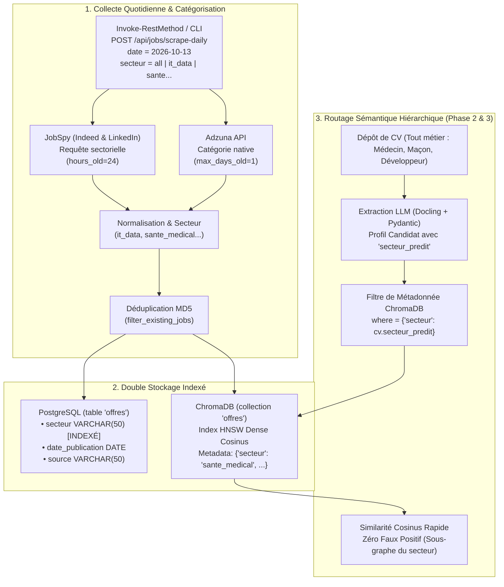
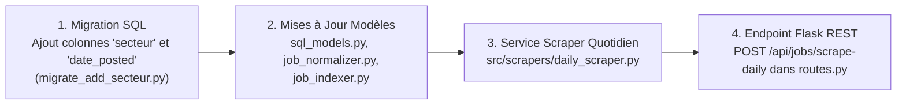

# Spécification Technique : Moteur Multi-Secteurs & Scraping Quotidien par Date
> **Projet Master 2 IA** — Système Universel de Recommandation d'Offres d'Emploi par Analyse de CV  
> **Composants** : Classification Sectorielle, Routage Sémantique Hiérarchique & Pipeline Quotidien  
> **Stockage** : PostgreSQL (`offres.secteur`) & ChromaDB (`metadata={"secteur": ...}`)  
> **Interface REST** : Endpoint Flask `POST /api/jobs/scrape-daily`

---

## 1. Vision & Architecture Globale

Le projet évolue d'un outil mono-métier vers une **plateforme universelle de recrutement multi-secteurs** (Médecine, BTP, Commerce, Informatique, Finance, Industrie...).



---

## 2. Taxonomie Universelle des 8 Secteurs

Pour garantir une catégorisation propre sans éparpillement, l'ensemble des offres et des profils est normalisé sur **8 grands secteurs d'activité** :

| Code Secteur (`secteur`) | Libellé Métier | Catégorie Adzuna Correspondante | Exemples de Mots-Clés JobSpy |
| :--- | :--- | :--- | :--- |
| **`it_data`** | Informatique, Data, IA & Web | `it-jobs` | Data Scientist, Développeur, DevOps, IA |
| **`sante_medical`** | Santé, Soins, Pharmacie & Médical | `healthcare-nursing-jobs` | Infirmier, Médecin, Pharmacien, Biologie |
| **`btp_construction`** | BTP, Bâtiment, Travaux & Architecture | `trade-construction-jobs` | Conducteur de travaux, Maçon, Architecte |
| **`commerce_marketing`** | Vente, Marketing, Relation Client | `sales-jobs` / `marketing-jobs` | Commercial, Business Developer, Marketing |
| **`finance_gestion`** | Comptabilité, Audit, Banque, Finance | `accounting-finance-jobs` | Comptable, Contrôleur de gestion, Audit |
| **`industrie_ingenierie`** | Ingénierie, Usinage, Logistique | `engineering-jobs` / `logistics-warehouse-jobs` | Ingénieur mécanique, Logistique, Usine |
| **`rh_juridique`** | Ressources Humaines, Recrutement, Droit | `hr-jobs` / `legal-jobs` | Chargé de recrutement, Juriste, RH |
| **`general_autre`** | Autres services, Hôtellerie, Restauration | `hospitality-catering-jobs` / `other-general-jobs` | Polyvalent, Accueil, Restauration |

---

## 3. Évolution du Modèle de Données

### 3.1 PostgreSQL : Table `offres`
Ajout de deux colonnes clés pour le tri temporel et sectoriel :
```sql
ALTER TABLE offres ADD COLUMN IF NOT EXISTS secteur VARCHAR(50) DEFAULT 'it_data';
ALTER TABLE offres ADD COLUMN IF NOT EXISTS date_posted DATE DEFAULT CURRENT_DATE;

CREATE INDEX IF NOT EXISTS idx_offres_secteur ON offres(secteur);
CREATE INDEX IF NOT EXISTS idx_offres_date_posted ON offres(date_posted);
```

### 3.2 ChromaDB : Métadonnées Vectorielles
Lors de l'indexation vectorielle dans `src/pipeline/job_indexer.py`, les métadonnées de chaque vecteur incluent désormais :
```python
metadatas = [
    {
        "poste": job.poste,
        "company": job.company,
        "location": job.location,
        "source": job.source,
        "secteur": job.secteur,        # 👈 Nouveau champ de filtrage
        "date_posted": str(job.date_posted),
        "type_de_contrat": job.type_de_contrat,
        "niveau_etude_min": int(job.niveau_etude_min),
    }
]
```

---

## 4. Spécification du Scraper Quotidien (`scrape-daily`)

### 4.1 Endpoint REST : `POST /api/jobs/scrape-daily`
Déclenchable facilement via PowerShell (`Invoke-RestMethod`), curl ou cron.

#### Paramètres JSON (tous optionnels) :
```json
{
  "date": "2026-10-13",
  "secteur": "it_data",
  "sources": ["adzuna", "indeed", "linkedin"],
  "limit_per_source": 20
}
```
- Si `date` est omis : prend automatiquement la date d'aujourd'hui (`date.today()`).
- Si `secteur` est `"all"` : boucle sur les 3 secteurs prioritaires ou sur Adzuna général.
- Si `sources` est omis : interroge Adzuna et JobSpy.

#### Réponse JSON retournée :
```json
{
  "status": "success",
  "target_date": "2026-10-13",
  "secteur": "it_data",
  "statistiques": {
    "adzuna_recues": 25,
    "indeed_recues": 18,
    "linkedin_recues": 12,
    "nouvelles_offres_sql": 45,
    "doublons_ignores": 10,
    "offres_vectorisees_chroma": 45
  }
}
```

### 4.2 Logique de Filtrage Temporel par Plateforme
1. **Adzuna** :
   - Paramètre API : `max_days_old = delta_jours + 1` (ex: `1` pour aujourd'hui).
   - Filtre strict Python : `item["created"].startswith(target_date)`.
2. **JobSpy (Indeed & LinkedIn)** :
   - Paramètre : `hours_old = 24` (ou `(delta_jours + 1) * 24`).
   - Filtre strict Python : vérification que `date_posted == target_date`.
3. **Déduplication automatique** :
   - Hachage MD5 déterministe (`company_poste_location`) pour ne jamais insérer deux fois la même offre.

---

## 5. Routage Sémantique lors du Dépôt de CV (Two-Stage Matching)

Lorsqu'un candidat soumet son CV (Phase 2 & Phase 3) :
1. **Étape 1 (Prédiction Sectorielle)** :
   Le LLM (Llama 3.2 via Docling) analyse le CV et extrait :
   `profil.secteur_predit` (ex: `"sante_medical"` pour un médecin, `"btp_construction"` pour un maçon).
2. **Étape 2 (Recherche Sémantique Vectorielle Filtrée)** :
   L'API interroge ChromaDB avec la clause de pré-filtrage strict :
   ```python
   results = collection.query(
       query_texts=[cv_markdown_resume],
       n_results=10,
       where={"secteur": profil.secteur_predit}  # 👈 Isole le sous-graphe sectoriel
   )
   ```
3. **Résultat** :
   - **Vitesse maximale** : HNSW ne parcourt que le sous-ensemble du secteur.
   - **Pertinence absolue** : Aucun risque d'avoir des recommandations aberrantes hors du domaine du candidat.

---

## 6. Plan d'Action d'Implémentation



### Étape 1 : Migration PostgreSQL
Création du script `src/database/migrate_add_secteur.py` pour ajouter les colonnes et taguer les 60 offres actuelles en `'it_data'`.

### Étape 2 : Service d'Orchestration Quotidien
Création de `src/scrapers/daily_scraper.py` qui coordonne la collecte par date, le typage sectoriel, la déduplication et l'indexation ChromaDB automatique.

### Étape 3 : Route Flask
Exposition de la route `POST /api/jobs/scrape-daily` dans `src/api/routes.py`.

---

## 7. Commandes de Test Prévues (PowerShell)

### Lancer le scraping des offres du jour en Informatique :
```powershell
Invoke-RestMethod -Uri http://127.0.0.1:5000/api/jobs/scrape-daily -Method Post -Body '{"secteur": "it_data", "limit_per_source": 15}' -ContentType "application/json"
```

### Lancer le scraping des offres du jour en Santé / Médical :
```powershell
Invoke-RestMethod -Uri http://127.0.0.1:5000/api/jobs/scrape-daily -Method Post -Body '{"secteur": "sante_medical", "limit_per_source": 15}' -ContentType "application/json"
```

### Lancer le scraping pour une date spécifique :
```powershell
Invoke-RestMethod -Uri http://127.0.0.1:5000/api/jobs/scrape-daily -Method Post -Body '{"date": "2026-10-13", "secteur": "btp_construction"}' -ContentType "application/json"
```
