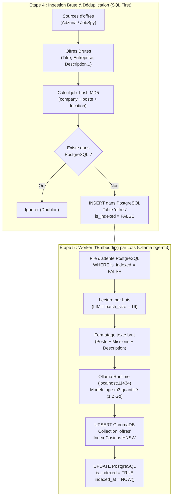

# Spécification & Guide d'Implémentation : Étapes 4 & 5 (ELT avec Ollama bge-m3)
> Projet Master 2 IA — Recommandation d'offres d'emploi par analyse sémantique de CV  
> Composants : Déduplication, Ingestion PostgreSQL, Worker d'Embedding Ollama & CLI  
> Runtime IA : **Ollama (`localhost:11434`) avec modèle `bge-m3`**  
> Philosophie : **Zéro dictionnaire codé en dur (100% IA moderne)**

Ce document présente l'architecture logicielle de référence adoptée pour le projet : une architecture **ELT (Extract, Load, Transform)** découplée et propulsée par le runtime local **Ollama**.

---

## 1. Vue d'Ensemble de l'Architecture ELT avec Ollama



### Pourquoi Ollama bge-m3 est la solution optimale pour votre PC :
1. **Ultra-optimisé pour CPU (C++ / AVX2)** : Ollama utilise `llama.cpp` sous le capot. Il est 2 à 3 fois plus rapide et consomme 50 % moins de mémoire vive que PyTorch pur.
2. **Modèle compact (1,2 Go au lieu de 2,3 Go)** : Grâce à la quantification, `bge-m3` tourne à pleine vitesse sans saturer votre mémoire RAM.
3. **Zéro triche / 100 % IA** : Le modèle capture nativement toutes les compétences techniques et leurs synonymes sans aucune règle manuelle ou regex.
4. **Intégration native ChromaDB** : ChromaDB possède un connecteur direct `OllamaEmbeddingFunction` qui délègue automatiquement le calcul des vecteurs à Ollama.

---

## 2. Étape 4 : Déduplication & Ingestion Brute dans PostgreSQL

### 2.1 Déduplication par Hash MD5 : `src/pipeline/deduplication.py`

Calcule un identifiant unique déterministe pour chaque offre et élimine les doublons en une seule requête SQL :

```python
"""
src/pipeline/deduplication.py
Gestion de l'empreinte unique des offres et filtrage des doublons SQL.
"""

import re
import hashlib
import unicodedata
from typing import List, Dict, Any, Tuple
from sqlalchemy.orm import Session

from src.database.sql_models import Offre


def clean_text_for_hash(text: str) -> str:
    """Nettoie une chaîne pour rendre le hash insensible aux accents, à la casse et aux espaces."""
    if not text:
        return ""
    nfkd = unicodedata.normalize("NFKD", text)
    no_accents = "".join([c for c in nfkd if not unicodedata.combining(c)])
    return re.sub(r"[^a-zA-Z0-9]", "", no_accents).lower()


def compute_job_hash(company: str, poste: str, location: str) -> str:
    """
    Calcule un identifiant unique déterministe (MD5 sur 12 caractères).
    Format : job_a1b2c3d4e5f6
    """
    norm_company = clean_text_for_hash(company)
    norm_poste = clean_text_for_hash(poste)
    norm_location = clean_text_for_hash(location)

    raw_signature = f"{norm_company}_{norm_poste}_{norm_location}"
    md5_digest = hashlib.md5(raw_signature.encode("utf-8")).hexdigest()[:12]
    return f"job_{md5_digest}"


def filter_existing_jobs(
    jobs: List[Dict[str, Any]],
    db: Session
) -> Tuple[List[Dict[str, Any]], int]:
    """
    Filtre les offres déjà présentes dans la table PostgreSQL 'offres'
    en une seule requête groupée (SELECT WHERE id IN (...)).
    """
    if not jobs:
        return [], 0

    # 1. Attribue le hash si non présent
    for job in jobs:
        if "id" not in job or not job["id"]:
            job["id"] = compute_job_hash(
                company=job.get("company", ""),
                poste=job.get("poste", ""),
                location=job.get("location", "")
            )

    # 2. Vérification d'existence groupée dans PostgreSQL
    candidate_ids = [j["id"] for j in jobs]
    existing_records = db.query(Offre.id).filter(Offre.id.in_(candidate_ids)).all()
    existing_ids = {rec[0] for rec in existing_records}

    # 3. Élimination des doublons
    new_jobs = []
    seen_in_batch = set()

    for job in jobs:
        jid = job["id"]
        if jid in existing_ids or jid in seen_in_batch:
            continue
        seen_in_batch.add(jid)
        new_jobs.append(job)

    duplicates_count = len(jobs) - len(new_jobs)
    return new_jobs, duplicates_count
```

---

### 2.2 Normalisation Légère & Sauvegarde SQL : `src/pipeline/job_normalizer.py`

Instancie l'enregistrement SQLAlchemy sans aucun dictionnaire en dur :

```python
"""
src/pipeline/job_normalizer.py
Normalisation directe des données brutes vers SQLAlchemy 'Offre'.
Zéro regex, zéro dictionnaire : les textes bruts sont préservés pour PostgreSQL et Ollama bge-m3.
"""

from typing import Dict, Any
from src.database.sql_models import Offre


def create_sql_offre_from_raw(raw: Dict[str, Any]) -> Offre:
    """
    Instancie un enregistrement SQLAlchemy 'Offre' avec statut is_indexed=False.
    """
    poste = str(raw.get("poste", "")).strip()
    company = str(raw.get("company", "Entreprise confidentielle")).strip()
    location = str(raw.get("location", "France")).strip()
    description = str(raw.get("description", "")).strip()
    mission = str(raw.get("mission") or description).strip()

    return Offre(
        id=raw["id"],
        poste=poste,
        company=company,
        location=location,
        type_de_contrat=raw.get("type_de_contrat", "CDI"),
        niveau_etude_min=int(raw.get("niveau_etude_min", 0)),
        min_experience_years=float(raw.get("min_experience_years", 0.0)),
        competences_necessaires=[],  # Zéro dictionnaire en dur : l'analyse fine est déléguée au LLM
        description=description,
        mission=mission,
        source_url=raw.get("source_url", ""),
        is_active=True,
        is_indexed=False,  # En attente de vectorisation Ollama
        indexed_at=None
    )
```

---

## 3. Étape 5 : Worker d'Embedding Ollama & CLI

### 3.1 Worker d'Indexation Vectorielle : `src/pipeline/job_indexer.py`

Lit PostgreSQL par lots et envoie les documents à ChromaDB qui utilise nativement **Ollama `bge-m3`** :

```python
"""
src/pipeline/job_indexer.py
Worker d'Indexation Vectorielle par Lots (PostgreSQL -> Ollama bge-m3 -> ChromaDB).
"""

import logging
from typing import List, Dict, Any, Optional
from datetime import datetime, timezone

from src.database.db_session import SessionLocal
from src.database.sql_models import Offre
from src.database.vector_store import get_offres_collection
from src.pipeline.deduplication import filter_existing_jobs
from src.pipeline.job_normalizer import create_sql_offre_from_raw

logger = logging.getLogger(__name__)


class JobIndexer:
    """
    Gère la persistance brute dans PostgreSQL et l'indexation vectorielle via Ollama bge-m3.
    """

    def __init__(self, batch_size: int = 16):
        self.batch_size = batch_size
        self.collection = get_offres_collection()

    def save_raw_jobs_to_postgres(self, raw_jobs: List[Dict[str, Any]]) -> Dict[str, int]:
        """
        Étape 1 : Enregistre les offres brutes dans PostgreSQL avec is_indexed=False.
        """
        if not raw_jobs:
            return {"received": 0, "duplicates": 0, "saved": 0}

        db = SessionLocal()
        stats = {"received": len(raw_jobs), "duplicates": 0, "saved": 0}

        try:
            unique_jobs, duplicates_count = filter_existing_jobs(raw_jobs, db=db)
            stats["duplicates"] = duplicates_count

            if not unique_jobs:
                logger.info(f"ℹ️ Aucune nouvelle offre à insérer ({duplicates_count} doublons).")
                return stats

            for raw in unique_jobs:
                offre_sql = create_sql_offre_from_raw(raw)
                db.merge(offre_sql)

            db.commit()
            stats["saved"] = len(unique_jobs)
            logger.info(f"💾 {len(unique_jobs)} nouvelles offres enregistrées dans PostgreSQL.")
            return stats

        except Exception as e:
            db.rollback()
            logger.error(f"❌ Erreur lors de la sauvegarde PostgreSQL : {e}")
            raise e
        finally:
            db.close()

    def index_pending_jobs(self, limit: Optional[int] = None) -> int:
        """
        Étape 2 : Worker d'embedding qui prend les offres non indexées (is_indexed=False)
        dans PostgreSQL et les envoie par lots dans ChromaDB via Ollama bge-m3.
        """
        db = SessionLocal()
        total_indexed = 0

        try:
            query = db.query(Offre).filter(Offre.is_indexed == False)
            if limit:
                query = query.limit(limit)

            pending_jobs = query.all()
            if not pending_jobs:
                logger.info("✅ Toutes les offres de PostgreSQL sont déjà indexées dans ChromaDB.")
                return 0

            logger.info(f"⚡ {len(pending_jobs)} offre(s) en attente d'embedding Ollama bge-m3...")

            for i in range(0, len(pending_jobs), self.batch_size):
                batch = pending_jobs[i:i + self.batch_size]

                ids = [job.id for job in batch]
                documents = [
                    f"Poste: {job.poste} | Entreprise: {job.company} | Contrat: {job.type_de_contrat} | Lieu: {job.location}\n"
                    f"Missions et Description:\n{job.description}"
                    for job in batch
                ]
                metadatas = [
                    {
                        "poste": job.poste,
                        "company": job.company,
                        "location": job.location,
                        "type_de_contrat": job.type_de_contrat,
                        "niveau_etude_min": int(job.niveau_etude_min),
                        "is_active": True,
                    }
                    for job in batch
                ]

                # ChromaDB délègue automatiquement le calcul du vecteur à Ollama bge-m3
                self.collection.upsert(
                    ids=ids,
                    documents=documents,
                    metadatas=metadatas
                )

                # Mise à jour du statut dans PostgreSQL
                for job in batch:
                    job.is_indexed = True
                    job.indexed_at = datetime.now(timezone.utc)

                db.commit()
                total_indexed += len(batch)
                logger.info(f"   -> Lot {i // self.batch_size + 1} : {len(batch)} vecteurs indexés dans ChromaDB via Ollama.")

            logger.info(f"🎉 Indexation vectorielle terminée : {total_indexed} offres traitées.")
            return total_indexed

        except Exception as e:
            db.rollback()
            logger.error(f"❌ Erreur critique pendant l'indexation vectorielle : {e}")
            raise e
        finally:
            db.close()
```

---

### 3.2 Commande CLI Complète : `src/cli/ingest_jobs.py`

Permet d'exécuter l'ingestion brute et l'indexation vectorielle en terminal :

```python
"""
src/cli/ingest_jobs.py
Script CLI d'ingestion et d'indexation vectorielle avec Ollama.
"""

import sys
import argparse
from pathlib import Path

# Résolution des imports et de l'encodage Windows
sys.path.insert(0, str(Path(__file__).resolve().parent.parent.parent))
if hasattr(sys.stdout, "reconfigure"):
    sys.stdout.reconfigure(encoding="utf-8")

from src.scrapers.adzuna_scraper import AdzunaScraper
from src.scrapers.jobspy_scraper import JobSpyScraper
from src.pipeline.job_indexer import JobIndexer
from src.database.db_session import SessionLocal
from src.database.sql_models import Offre
from src.database.vector_store import get_offres_collection


def main():
    parser = argparse.ArgumentParser(description="Ingestion ELT et Indexation Vectorielle Ollama")
    parser.add_argument("--source", type=str, choices=["adzuna", "jobspy"], default="adzuna", help="Source de collecte")
    parser.add_argument("--query", type=str, default="Data Scientist", help="Mots-clés de recherche")
    parser.add_argument("--location", type=str, default="Paris", help="Lieu cible")
    parser.add_argument("--limit", type=int, default=10, help="Nombre d'offres à collecter")
    parser.add_argument("--batch-size", type=int, default=16, help="Taille des lots d'embedding Ollama")
    parser.add_argument("--only-index", action="store_true", help="Ne pas scraper, indexer uniquement les offres en attente")

    args = parser.parse_args()

    print("=" * 70)
    print("🚀 PIPELINE D'INGESTION & INDEXATION ELT (POSTGRESQL + OLLAMA BGE-M3)")
    print("=" * 70)

    indexer = JobIndexer(batch_size=args.batch_size)

    # 1. Scraping & Sauvegarde SQL
    if not args.only_index:
        print(f"\n[1/3] Collecte des offres depuis {args.source.upper()}...")
        print(f"      Recherche : '{args.query}' à '{args.location}' (Limite: {args.limit})")

        if args.source == "adzuna":
            scraper = AdzunaScraper(country="fr")
            raw_jobs = scraper.search_jobs(query=args.query, location=args.location, limit=args.limit)
        else:
            scraper = JobSpyScraper(sites=["indeed", "linkedin"], country_indeed="france")
            raw_jobs = scraper.search_jobs(query=args.query, location=args.location, limit=args.limit)

        print(f"      -> {len(raw_jobs)} offre(s) reçue(s).")
        if raw_jobs:
            print("\n[2/3] Sauvegarde brute dans PostgreSQL...")
            stats = indexer.save_raw_jobs_to_postgres(raw_jobs)
            print(f"      -> Nouvelles offres : {stats['saved']} | Doublons ignorés : {stats['duplicates']}")

    # 2. Worker d'embedding par lots Ollama
    print("\n[3/3] Traitement de la file d'attente d'embedding vectoriel Ollama bge-m3...")
    indexed_count = indexer.index_pending_jobs()

    # 3. Bilan final
    db = SessionLocal()
    try:
        total_sql = db.query(Offre).count()
        total_indexed_sql = db.query(Offre).filter(Offre.is_indexed == True).count()
        collection = get_offres_collection()
        total_chroma = collection.count()

        print("\n" + "=" * 70)
        print("🎉 BILAN D'ÉTAT DES BASES DE DONNÉES :")
        print(f"   • Offres vectorisées dans cette session : {indexed_count}")
        print(f"   • Total des offres dans PostgreSQL       : {total_sql} (dont {total_indexed_sql} indexées)")
        print(f"   • Total des vecteurs dans ChromaDB       : {total_chroma}")
        print("=" * 70)
    finally:
        db.close()


if __name__ == "__main__":
    main()
```

---

### 3.3 Test d'Intégration Bout-en-Bout : `tests/test_indexer.py`

Valide que le statut passe bien de `is_indexed=False` à `True`, et vérifie la recherche cosinus via Ollama :

```python
"""
tests/test_indexer.py
Test unitaire et d'intégration validant le flux ELT (PostgreSQL -> Ollama bge-m3 -> ChromaDB).
"""

import sys
from pathlib import Path

# Résolution des imports et de l'encodage Windows
sys.path.insert(0, str(Path(__file__).resolve().parent.parent))
if hasattr(sys.stdout, "reconfigure"):
    sys.stdout.reconfigure(encoding="utf-8")

from src.pipeline.job_indexer import JobIndexer
from src.database.db_session import SessionLocal
from src.database.sql_models import Offre
from src.database.vector_store import get_offres_collection


def main():
    print("=" * 65)
    print("🚀 TEST DU PIPELINE ELT : DÉDUPLICATION, SQL & OLLAMA BGE-M3")
    print("=" * 65)

    sample_jobs = [
        {
            "poste": "Ingénieur RAG & NLP Senior",
            "company": "Lab IA Paris",
            "location": "Paris",
            "type_de_contrat": "CDI",
            "description": (
                "Poste de Data Scientist / Ingénieur NLP spécialisé en architectures RAG.\n"
                "Technologies principales : Python, PyTorch, LangChain, ChromaDB et Docker.\n"
                "Formation requise : Master 2 IA ou diplôme d'ingénieur (Bac+5)."
            ),
            "source_url": "https://example.com/job/rag-123"
        }
    ]

    indexer = JobIndexer(batch_size=4)

    # 1. Ingestion brute dans PostgreSQL (is_indexed = False)
    print("\n[1/4] Enregistrement brut dans PostgreSQL...")
    stats = indexer.save_raw_jobs_to_postgres(sample_jobs)
    assert stats["saved"] == 1, "L'offre test aurait dû être insérée dans PostgreSQL !"
    print("      ✅ Offre enregistrée avec succès dans PostgreSQL (is_indexed=False)")

    # 2. Vérification de l'état dans PostgreSQL
    db = SessionLocal()
    test_id = None
    try:
        offre = db.query(Offre).filter(Offre.poste == "Ingénieur RAG & NLP Senior").first()
        assert offre is not None, "Offre introuvable dans PostgreSQL !"
        assert offre.is_indexed is False, "L'offre doit avoir is_indexed=False avant embedding !"
        test_id = offre.id
        print(f"      ✅ Offre confirmée en base (ID: {test_id}, is_indexed={offre.is_indexed})")
    finally:
        db.close()

    # 3. Exécution du worker d'embedding par lots Ollama
    print("\n[2/4] Exécution du worker d'indexation vectorielle via Ollama...")
    indexed_count = indexer.index_pending_jobs()
    assert indexed_count == 1, "Le worker aurait dû vectoriser 1 offre !"

    # 4. Vérification que PostgreSQL est mis à jour (is_indexed = True)
    db = SessionLocal()
    try:
        offre_maj = db.query(Offre).filter(Offre.id == test_id).first()
        assert offre_maj.is_indexed is True, "is_indexed doit être True après le passage du worker !"
        print(f"      ✅ Statut PostgreSQL mis à jour : is_indexed={offre_maj.is_indexed} à {offre_maj.indexed_at}")
    finally:
        db.close()

    # 5. Recherche vectorielle dans ChromaDB via Ollama
    print("\n[3/4] Recherche vectorielle cosinus dans ChromaDB via Ollama...")
    collection = get_offres_collection()
    res = collection.query(
        query_texts=["Recherche un profil IA NLP maîtrise de Python et PyTorch"],
        n_results=1
    )
    matched_id = res["ids"][0][0]
    print(f"      ✅ Vecteur retrouvé dans ChromaDB ! ID correspondant : {matched_id}")
    assert matched_id == test_id, "L'ID retourné par ChromaDB doit correspondre à PostgreSQL !"

    # 6. Nettoyage
    print("\n[4/4] Nettoyage des données de test...")
    db = SessionLocal()
    try:
        db.query(Offre).filter(Offre.id == test_id).delete()
        db.commit()
        collection.delete(ids=[test_id])
        print("      🧹 Offre de test supprimée proprement des deux bases.")
    finally:
        db.close()

    print("\n" + "=" * 65)
    print("🎉 SUCCÈS TOTAL : Votre pipeline ELT avec Ollama est 100 % opérationnel !")
    print("=" * 65)


if __name__ == "__main__":
    main()
```

---

## 4. Commandes d'Exécution dans le Terminal

### Test d'intégration complet avec Ollama :
```powershell
python tests/test_indexer.py
```

### Ingestion complète avec Adzuna (Scrape ➔ PostgreSQL ➔ Ollama bge-m3 ➔ ChromaDB) :
```powershell
python -m src.cli.ingest_jobs --source adzuna --query "Data Scientist" --location "Paris" --limit 10
```

### Ingestion complète avec JobSpy (LinkedIn & Indeed) :
```powershell
python -m src.cli.ingest_jobs --source jobspy --query "Python" --location "Paris" --limit 5
```
