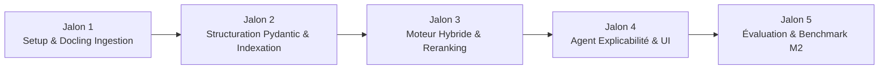

# Feuille de Route & Jalons d'Implémentation
> Projet Master 2 IA — Planification, Jalons et Métriques d'Évaluation

Ce document détaille les phases d'implémentation, les livrables attendus pour un projet académique d'excellence en M2 IA, ainsi que le protocole expérimental d'évaluation.

---

## 1. Calendrier des Jalons (Phases du Projet)

### Jalon 1 : Environnement & Module d'Ingestion Documentaire (Docling)
- **Objectifs** :
  - Création de l'environnement virtuel (`venv` ou `uv`) avec `requirements.txt`.
  - Implémentation du module `src/parsers/docling_parser.py`.
  - Tests sur un échantillon de 10 CVs aux designs variés (1 colonne, 2 colonnes asymétriques, tableaux de compétences, icônes).
- **Livrable** : Script CLI capable de convertir un dossier de PDF en Markdown propre et structuré.

### Jalon 2 : Structuration Pydantic & Double Stockage (ChromaDB + PostgreSQL)
- **Objectifs** :
  - Implémentation du parseur structuré `src/parsers/profile_extractor.py` (LLM + Pydantic).
  - Mise en place de la base relationnelle PostgreSQL (`src/database/sql_models.py`) avec tables `cv_users`, `offres` et `evaluations` (JSONB, TEXT[] et index GIN).
  - Constitution d'un jeu de données initial d'offres d'emploi (50 à 200 offres tech / data / IA).
  - Indexation vectorielle dans ChromaDB (`src/database/vector_store.py`) et indexation lexicale BM25.
- **Livrable** : Base vectorielle et PostgreSQL peuplées et synchronisées par IDs, interrogeables via filtres SQL et similarité cosinus.

### Jalon 3 : Moteur de Recherche Hybride & Reranker Neuronal
- **Objectifs** :
  - Intégration de l'algorithme de fusion de rangs (Reciprocal Rank Fusion ou combinaison pondérée).
  - Intégration du modèle de Cross-Encoder (`bge-reranker-v2-m3`).
  - Validation expérimentale de l'amélioration de pertinence apportée par le Reranker vs recherche vectorielle brute.
- **Livrable** : Module de scoring capable de classer les offres les plus pertinentes pour un profil donné.

### Jalon 4 : Agent d'Explicabilité & Démonstrateur Interactif
- **Objectifs** :
  - Implémentation de l'agent d'analyse de gaps (`src/agents/explainability.py`).
  - Développement de l'interface graphique Streamlit (`src/ui/app_streamlit.py`) :
    - Glisser-déposer de CV (PDF).
    - Visualisation du CV converti en Markdown et du profil extrait.
    - Sélection des filtres souhaités (Type de contrat, Ville, Télétravail).
    - Affichage des offres classées avec badges de compétences et explication détaillée du match.
- **Livrable** : Application de démonstration fonctionnelle de bout en bout.

### Jalon 5 : Benchmark Scientifique & Rapport Final M2 IA
- **Objectifs** :
  - Évaluation quantitative sur un jeu de test annoté (Gold Standard).
  - Mesure des métriques de Retrieval de l'état de l'art.
  - Rédaction du mémoire / rapport technique et soutenance.
- **Livrable** : Notebook de métriques et rapport de projet finalisé.

---

## 2. Protocole d'Évaluation Scientifique (Spécifique M2 IA)

Pour justifier la rigueur de la démarche auprès du jury universitaire, le projet intègre des métriques quantitatives et qualitatives :

### 2.1 Métriques de Recherche d'Information (Information Retrieval - IR)
Sur un échantillon de test de 20 profils avec des correspondances annotées (jugements de pertinence binaire ou graduel de 0 à 3) :

1. **Recall@K ($K \in \{5, 10, 20\}$)** :
   Vérifier que les offres idéales se trouvent bien dans le Top-K retourné par la phase d'extraction.
2. **Mean Reciprocal Rank (MRR)** :
   Mesure la position moyenne de la première offre hautement pertinente :
   $$\text{MRR} = \frac{1}{|Q|} \sum_{i=1}^{|Q|} \frac{1}{\text{rank}_i}$$
3. **Normalized Discounted Cumulative Gain (nDCG@K)** :
   Évalue la qualité du classement en accordant plus de poids aux offres très pertinentes placées en haut de liste.

### 2.2 Ablation Study (Étude d'Ablation)
Comparer 4 configurations du pipeline pour prouver la valeur ajoutée de chaque brique :
- **Baseline 1** : Recherche TF-IDF / BM25 pure (mots-clés).
- **Baseline 2** : Recherche Vectorielle Dense pure (ChromaDB + BGE-M3 seul).
- **Approche Hybride** : BM25 + BGE-M3 (sans reranking).
- **Pipeline Complet** : Hybride (BM25 + BGE-M3) + Cross-Encoder Reranker.

### 2.3 Métriques de Performance & Latence
- Temps moyen de parsing Docling par page de CV (secondes).
- Temps de réponse de la recherche hybride + reranking (millisecondes).
- Temps de génération de l'explication LLM.
